# Guía de uso de «¿Puedo comerlo?»

Para quien la va a usar y para quien la va a probar. Se lee en el móvil en unos diez minutos.

---

## Índice

1. [Qué es y qué no es](#1-qué-es-y-qué-no-es)
2. [Los colores](#2-los-colores)
3. [El primer arranque](#3-el-primer-arranque)
4. [Embutidos y fiambres](#4-cómo-trata-la-app-los-embutidos-y-los-fiambres)
5. [Comer fuera](#5-comer-fuera)
6. [En el súper](#6-en-el-súper)
7. [Las claves del embarazo](#7-las-claves-del-embarazo)
8. [Lista de la compra, favoritos e historial](#8-lista-de-la-compra-favoritos-e-historial)
9. [Ajustes](#9-ajustes)
10. [Instalarla en el móvil](#10-instalarla-en-el-móvil)
11. [Privacidad, en claro](#11-privacidad-en-claro)
12. [Prueba de 5 minutos](#12-prueba-de-5-minutos-familia-y-amigos)
13. [Preguntas frecuentes](#13-preguntas-frecuentes)

---

## 1. Qué es y qué no es

«¿Puedo comerlo?» te da una respuesta corta antes de pedir en un restaurante o de meter algo en el carro
durante el embarazo. Primero la respuesta; el motivo, solo si lo abres.

- **Es orientativa.** No es una app médica y no hay un médico detrás.
- **No sustituye a tu matrona, a tu ginecólogo ni a tu médico.** Si tienes una duda sobre tu caso,
  pregúntales a ellos. Por eso, abajo, en todas las pantallas, verás siempre esta frase:
  «Orientativa. No sustituye el consejo de tu matrona, ginecólogo o médico.»
- **Sus fuentes son públicas:** la AESAN (Agencia Española de Seguridad Alimentaria y Nutrición) y notas
  del Ministerio de Sanidad. Cada respuesta dice de dónde sale. Cuando la app no entiende un plato, lo
  dice y no se inventa la respuesta.
- **No te pide nada clínico:** ni semana de embarazo, ni fecha de parto, ni analíticas.

---

## 2. Los colores

Cuando la app te contesta sobre **un plato o un producto**, pinta **la pantalla entera** del color de la
respuesta (también la barra de arriba y la de abajo) y escribe la palabra en grande. Hay cuatro respuestas:

| Respuesta | Color | Qué quiere decir |
|---|---|---|
| **Sí** | verde | Se puede tomar **tal como se sirve normalmente**. Si hay algo que vigilar, va debajo, en «Ojo con esto». |
| **Con cuidado** | naranja | Depende de **un dato que no se ve** en el plato (por ejemplo, si el huevo está crudo). Trae una «Pregunta» concreta para el camarero. |
| **Mejor no** | rojo vino | Tiene un **riesgo real** en el embarazo. Si hay una alternativa, la propone. |
| **No estoy segura** | ocre | **No lo conozco.** La app no lo da por seguro y no se inventa la respuesta. |

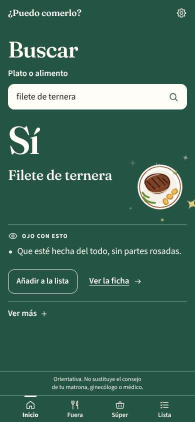

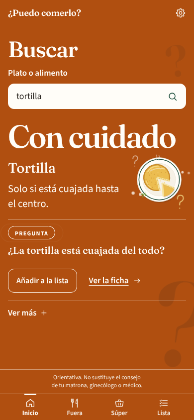

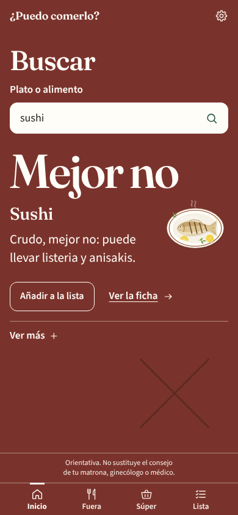

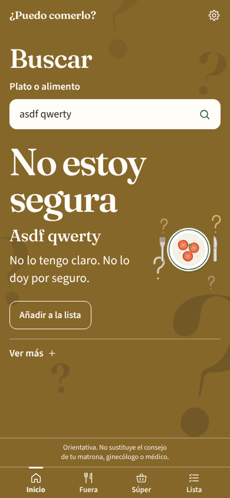

**No te fíes solo del color.** Siempre hay una **palabra** («Sí», «Con cuidado», «Mejor no», «No estoy
segura») y una frase. Además, «Con cuidado» y «No estoy segura» llevan signos de interrogación flotando de
fondo, y «Mejor no» una cruz grande, para distinguirlos de un vistazo aunque no veas bien los colores.

### «Ojo con esto» y «Pregunta»

- **«Ojo con esto»** son uno, dos o tres avisos cortos que salen **debajo de un «Sí»** (a veces también de
  un «Con cuidado»). No cambian la respuesta: dicen lo que conviene vigilar de siempre, como la cocción, el
  lavado, que sea pasteurizado o la moderación. Ejemplos con el motor de la app:
  - «Filete de ternera» → **Sí**, y debajo: «Que esté hecha del todo, sin partes rosadas.»
  - «Hamburguesa» → **Sí**, con el mismo aviso.
  - «Café» → **Sí**, con «Con moderación: lleva cafeína.»
  - «Pizza de jamón york» → **Sí**, con «Lo de encima, al horno y no puesto al final.»
- **«Pregunta»** es lo que le puedes decir al camarero cuando la respuesta es **Con cuidado**. Ejemplo:
  «Tortilla» → **Con cuidado**, y la pregunta es «¿La tortilla está cuajada del todo?». Según lo que te
  contesten, el plato pasa a ser un «Sí» o un «Mejor no».
- Un «Sí» nunca es naranja solo porque convenga revisar algo: lo naranja se reserva para cuando hay un dato
  que de verdad lo cambia todo.

### Imagen y movimiento

Junto al nombre verás un **dibujo del tipo de comida** (carne, pescado, ensalada, pasta, postre…). Al llegar
la respuesta, la pantalla se ilumina del color: en «Sí» hay chispas doradas; en «Mejor no», la palabra cae y
se dibuja una cruz; en las dudas, los signos de interrogación flotan. Si tienes activado **«Reducir
movimiento»** en el móvil, todo se queda quieto.

### Gana el peor

Si un plato junta varias cosas, se queda con la respuesta más prudente: «Mejor no» manda sobre «Con
cuidado», que manda sobre «No estoy segura», que manda sobre «Sí». Por ejemplo, una ensalada con salmón
ahumado sale «Mejor no» por el ahumado, aunque la ensalada sola fuera «Sí».

### Listas y «Ver más»

La carta, tu lista, el historial y «Lo último» no se pintan enteros: van sobre fondo crema, y cada plato es
una fila con una **banda suave del color** de su respuesta, una marca de color en el borde, el dibujo
pequeño de su tipo de comida y, si lo hay, el primer aviso de «Ojo con esto».

Si tocas **Ver más** se despliega el resto: el motivo, la alternativa, los demás avisos, los temas
relacionados («Para saber más») y la fuente.

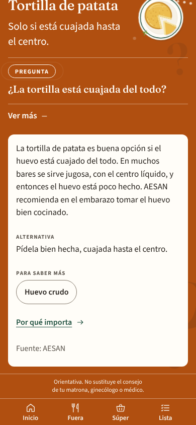

---

## 3. El primer arranque

La primera vez que la abres te hace tres pantallas cortas, una sola vez (cuatro pasos contando la portada).
Lo que contestes se puede cambiar después en Ajustes. Arriba verás siempre «Paso 1 de 4» y una barra de
progreso; con **Atrás** vuelves al paso anterior.

**Paso 1. Portada.** Explica qué es la app, con una mesa de doce platos vista desde arriba (en una esquina,
una servilleta con una silueta bordada de embarazada). Toca **Seguir**; debajo del botón está el aviso de que
es orientativa.

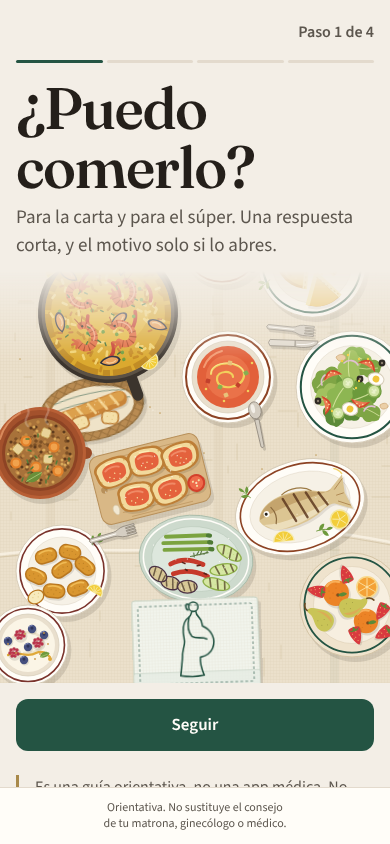

**Paso 2. Alergias e intolerancias.** Opcional: leche, huevo, gluten, frutos secos, pescado, marisco, soja y
sésamo. Debajo hay un campo corto (hasta 200 letras) para **otra cosa que no quieras comer**, por ejemplo
«cilantro». Si algo de lo que marques aparece en el plato o en la etiqueta, sale «Mejor no».

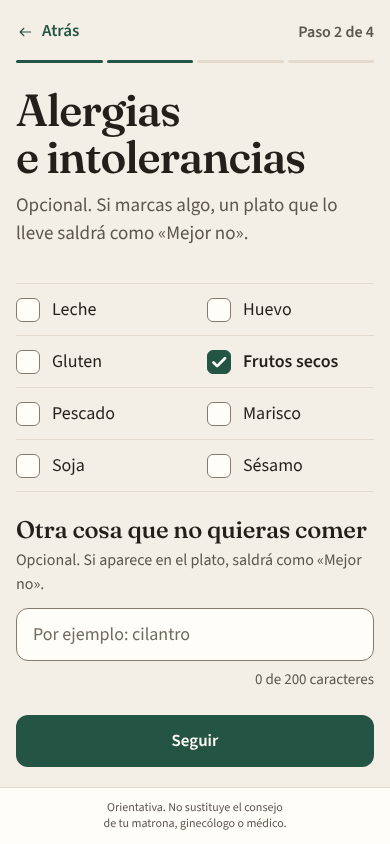

**Paso 3. Dietas y restricciones.** Opcional y se pueden marcar varias: vegetariana, vegana, sin cerdo, sin
lactosa (intolerancia). **No cambia la respuesta ni su color**; solo añade una nota, como «No encaja con
vegana» o «Lleva cerdo».

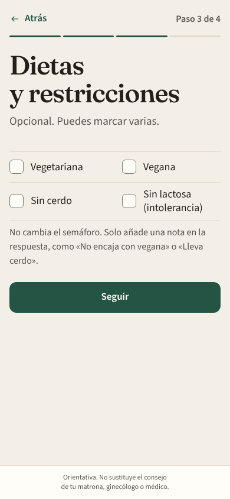

**Paso 4. Tu privacidad.** Tres frases: no te pedimos la semana de embarazo ni analíticas; tus alergias y tu
lista se quedan en este móvil y no hay cuenta; la foto se envía solo para leer el texto, no se guarda, y el
semáforo lo calculan reglas fijas. Toca **Empezar**.

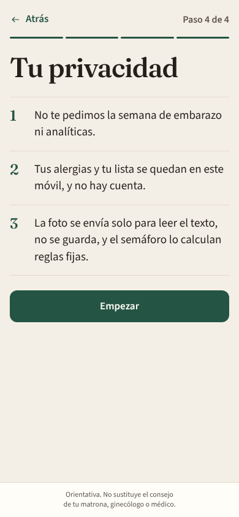

Llegas a **Inicio**: «¿Qué vas a comer?». Hay dos accesos grandes, **Comer fuera** y **En el súper**, y
debajo un campo para escribir el plato directamente.

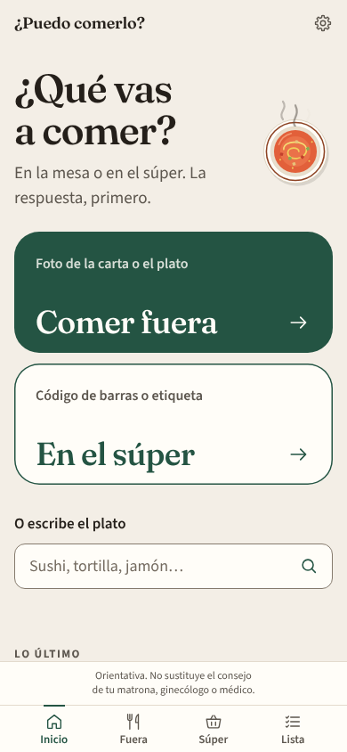

Más abajo está «Lo último» (vacío al principio, con un plato dibujado), un acceso a **Las claves del
embarazo** (apartado 7) y un aviso discreto que te ofrece ponerla en la pantalla de inicio del móvil; lo
puedes cerrar con la «x».

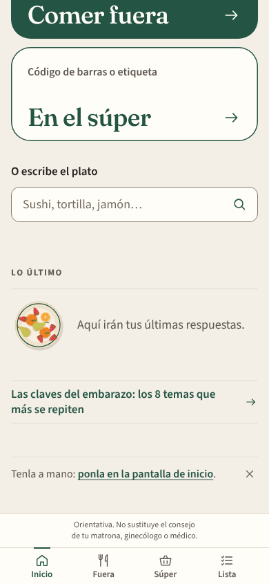

Abajo tienes siempre cuatro botones: **Inicio, Fuera, Súper y Lista**. Arriba a la derecha, la
ruedecita lleva a **Ajustes**.

---

## 4. Cómo trata la app los embutidos y los fiambres

La app **no te pregunta** por los embutidos: aplica siempre la misma regla prudente, en todos los móviles.
Si tu matrona o tu médico te han dicho algo distinto para tu caso, haz lo que ellos te digan.

- **Crudo, «Mejor no».** El jamón curado (el serrano, por ejemplo), el chorizo, el salchichón, el fuet y el
  lomo embuchado se curan sin cocinar. AESAN los señala por toxoplasmosis. Ejemplos: «jamón serrano»,
  «chorizo», «fuet», «bocadillo de lomo embuchado».
- **Cocinado dentro del plato, «Sí».** Si el embutido se cocina de verdad con el plato y llega bien
  caliente, el calor elimina el riesgo. Ejemplos: «pizza de jamón serrano», «croquetas de jamón», «guiso de
  chorizo», «lentejas con chorizo», «sándwich mixto caliente».
- **El fiambre de bandeja en frío, «Mejor no».** El jamón york, las lonchas de pavo o el chopped, en un
  bocadillo, en una ensalada o tal cual, pueden llevar listeria. Ejemplos: «jamón york», «bocadillo de
  jamón york», «lonchas de pavo». Cocinado dentro del plato (pizza, croqueta, lasaña, sándwich mixto
  caliente), sale «Sí»: «pizza de jamón york».
- **Lo que se añade en frío al final cuenta como crudo.** «Pizza con jamón serrano al final» o «pizza de
  jamón crudo» salen «Mejor no», aunque la pizza esté horneada.

---

## 5. Comer fuera

En **Fuera** (o «Comer fuera» desde Inicio) tienes tres maneras de preguntar:

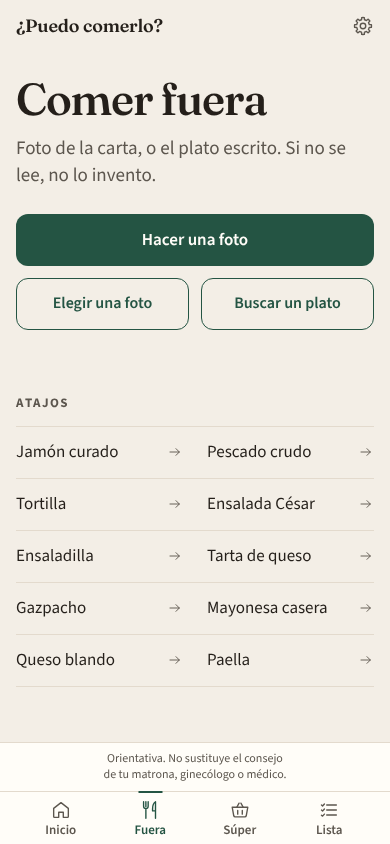

**Hacer una foto.** Abre la cámara de atrás. Encuadra la carta, con buena luz, y toca **Hacer la foto**.
Verás la foto congelada: si se lee bien, toca **Usar esta foto**; si no, **Repetir**. La primera vez, el
navegador te pedirá permiso para usar la cámara. Si no hay cámara o no le das permiso, te lo dice y te
ofrece elegir una foto de la galería.

**Elegir una foto.** Para una foto que ya tengas en el móvil (por ejemplo, la carta que te han mandado
por WhatsApp).

**Quién lee la foto.** La lee **Claude** (el modelo Sonnet 5.5) y tarda unos 4 segundos. Mientras tanto
verás la foto, un plato con tenedor y cuchillo que gira y el mensaje «Leyendo la carta…».

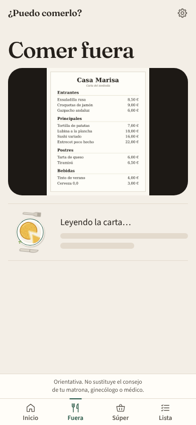

Después sale **«La carta»**: cuántos platos ha leído (hasta 12), un resumen por colores y una fila por plato,
con su banda de color, su dibujo y, si lo hay, un aviso. Toca **Ver más** en el que te interese. Abajo del
todo, **Hacer otra foto**.

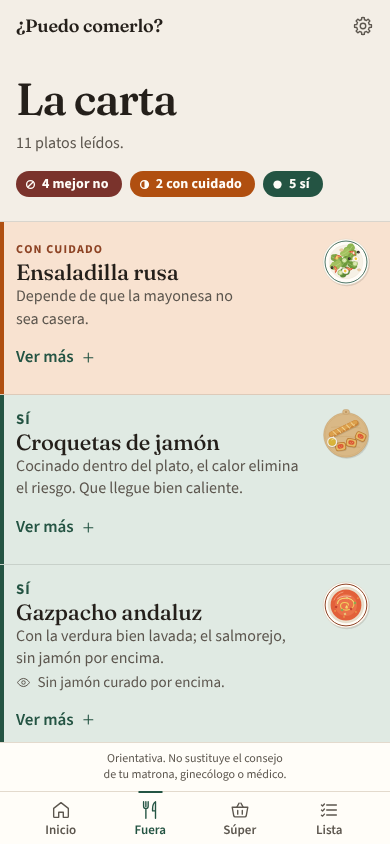

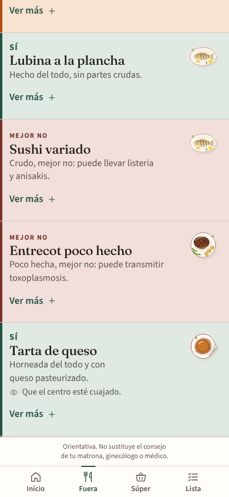

**Si no se lee**, la app no se inventa nada y te dice: «No he podido leer la carta. Acércala, o escribe
el plato.» Prueba otra foto más cerca y con más luz, o escríbelo.

**Si Claude no puede leerla** (por ejemplo, porque te has pasado del límite de fotos, apartado 13), la foto
se lee en el propio móvil. Es más lenta y menos fina, y la app te lo avisa con «He leído la carta de forma
aproximada. Revisa los nombres.» Entonces ningún plato sale «Sí» a secas (lo que habría sido «Sí» baja a
«No estoy segura»), y a veces se cuela una línea que no es un plato, como el nombre del restaurante. Si el
nombre está bien leído, escribe el plato en **Buscar** para confirmarlo.

**Buscar un plato.** Con **Buscar un plato**, o escribiendo en Inicio en «O escribe el plato», sale una
pantalla con el campo y **solo la respuesta**, con la pantalla del color de la respuesta: la palabra grande,
el nombre, una frase, los avisos, **Añadir a la lista** y **Ver más**. Escribe el plato como lo dirías:
«sushi», «tortilla», «pizza de jamón york», «lentejas con chorizo»… No hace falta poner tildes. La
respuesta (y el color) se van actualizando mientras escribes. Cuando la respuesta sale de un único alimento
conocido, aparece también **Ver la ficha**.

Si escribes algo que la app no entiende, sale **«No estoy segura»**, y en **Ver más** te dice qué
preguntar (si lleva huevo crudo, embutido, queso sin pasteurizar, alcohol o pescado sin hacer).

**Atajos.** Debajo de los botones hay una lista de texto con lo más habitual: jamón curado, pescado crudo,
tortilla, ensalada César, ensaladilla, tarta de queso, gazpacho, mayonesa casera, queso blando y paella.
Tocas uno y se abre su ficha, con su respuesta. También salen en Buscar cuando el campo está vacío.

---

## 6. En el súper

En **Súper** (o «En el súper» desde Inicio) tienes tres cosas: escanear el código de barras, escribirlo y
fotografiar la etiqueta.

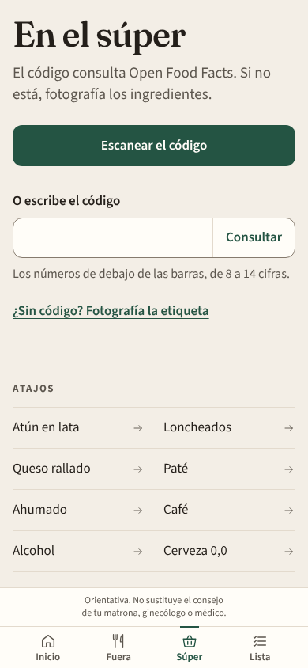

**Escanear el código.** Abre la cámara; apunta al código de barras y lo lee solo. **Escribir el código**: si
la cámara no lo coge, teclea los números de debajo de las barras (de 8 a 14 cifras) y toca **Consultar**.

La app busca el producto primero en **Open Food Facts**, una base de datos abierta de productos. Si el
producto trae su lista de ingredientes, sale la respuesta con la pantalla de su color, el código y el nombre.
En **Ver más** verás los ingredientes.

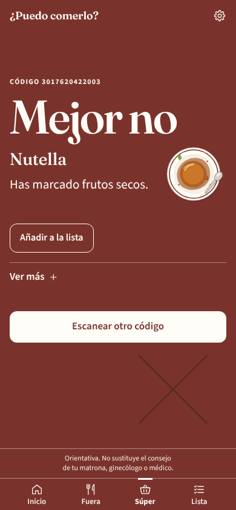

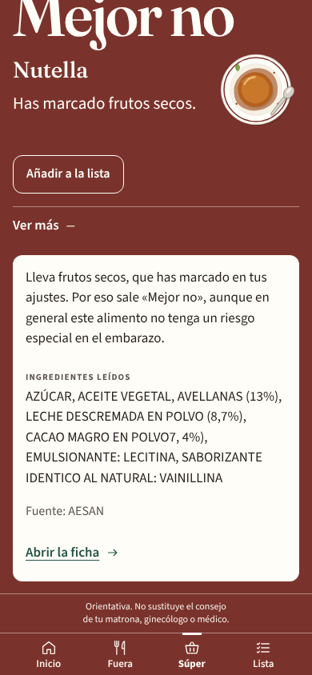

**Cómo se aplican tus alergias.**
- Si una alergia que has marcado aparece en los ingredientes o en los alérgenos del producto, sale
  **«Mejor no»** con la frase «Has marcado…» delante (en la captura, «Has marcado frutos secos», por las
  avellanas).
- Si solo aparece en las **trazas** («puede contener…»), una respuesta que habría sido «Sí» baja a
  **«Con cuidado»**, con «Puede llevar trazas de…» delante.
- Lo mismo con «otra cosa que no quieras comer»: si aparece, «Mejor no».

### Escaneo guiado: cuando faltan los ingredientes

A veces el producto está, pero **sin lista de ingredientes**. La app no adivina: sale **«No estoy segura»** y
un bloque que te guía:

- **«Me faltan los ingredientes».** Te dice que ha encontrado el producto por su nombre, pero que no trae
  la lista.
- **«Voy a mirar si lleva: …».** Te dice qué va a buscar en la etiqueta: huevo, leche o queso sin
  pasteurizar, embutido curado o carne cruda, pescado con mercurio, pescado crudo o ahumado, alcohol,
  cafeína, hierbas o infusiones (según el tipo de producto).
- **«Fotografiar los ingredientes».** Toca el botón y haz la foto de la lista de ingredientes, no del
  frente del paquete. Acerca la etiqueta, con buena luz, hasta que se lean las letras.

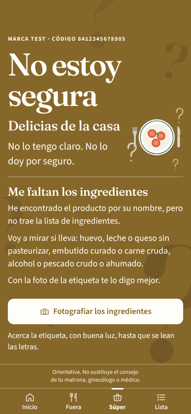

Tras la foto, la respuesta se vuelve a calcular y aparece **«Lo que he mirado en la etiqueta»**, **tema por
tema**: primero lo que **aparece** (con un aviso y un enlace «Por qué importa»), luego lo tranquilizador
(«Aparece leche pasteurizada: bien.») y, por último, lo que **no aparece** («No aparece alcohol.»).

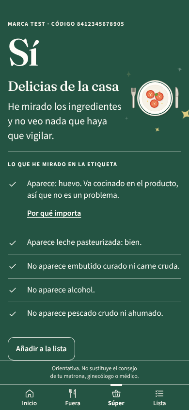

Si no se leen los ingredientes, la app dice «No he podido leer los ingredientes. Acércala, con buena luz.» y
te deja repetir la foto. Sin código, usa **«¿Sin código? Fotografía la etiqueta»**: se lee igual y, si hay
algo que mirar, sale también «Lo que he mirado en la etiqueta».

### Cuando el producto no está en Open Food Facts

Si Open Food Facts no tiene el producto, o lo tiene sin ingredientes, la app **lo busca en internet**.
Mientras tanto ves «Buscando en internet…» y un botón **Cancelar**. Tarda entre 10 y 20 segundos.

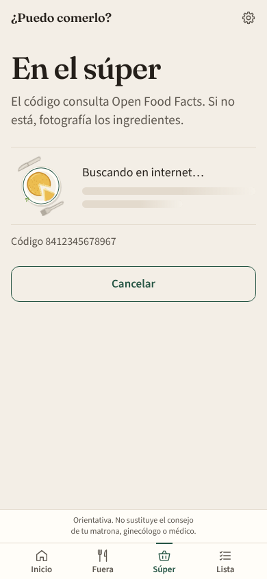

- Si lo encuentra, te enseña de dónde ha sacado los datos («Datos encontrados en internet (Alcampo)»), con
  un enlace a la página, y te pide que los **compruebes con la etiqueta**. **Los datos de internet nunca
  salen «Sí» por sí solos:** mientras no los confirmes con la foto de la etiqueta, la respuesta es «No
  estoy segura».
- Hay un límite: **6 búsquedas en internet por persona cada 10 minutos**. Pasado el límite, la app sigue
  funcionando con Open Food Facts y con la foto de la etiqueta.

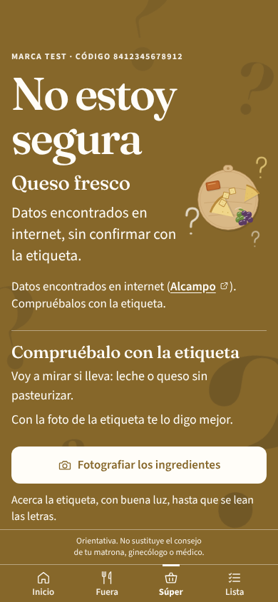

- Si no lo encuentra en ningún sitio, te lo dice con honestidad: **«No lo encuentro. Fotografía los
  ingredientes y lo miro por ti.»**

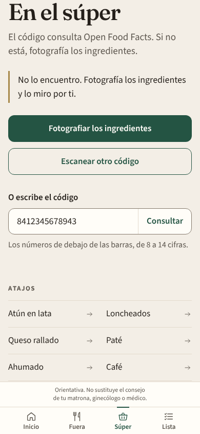

### Cuánto encuentra la app, con honestidad

Open Food Facts es una base abierta y no lo tiene todo. En los supermercados de marca blanca que hemos
probado, **solo trae la lista de ingredientes en unos 3 de cada 10 productos**; la búsqueda en internet
rescata una parte de los demás, y el resto se resuelve con la foto de los ingredientes, que es la red de
seguridad. **Mercadona no publica los códigos de barras de sus productos en su web**, así que con sus
productos la foto de los ingredientes se usará más. No es un fallo tuyo ni del móvil.

**Atajos del súper:** atún en lata, loncheados, queso rallado, paté, ahumado, café, alcohol y cerveza
0,0.

---

## 7. Las claves del embarazo

Hay **ocho temas** que se repiten una y otra vez durante el embarazo. La app los explica una sola vez, en
**Las claves del embarazo**, y los enlaza desde las respuestas:

**Listeria · Toxoplasmosis · Mercurio · Huevo crudo · Pescado crudo · Alcohol · Cafeína · Hierbas e
infusiones.**

Se llega desde **Inicio** (la línea «Las claves del embarazo: los 8 temas que más se repiten») y desde
**Ajustes → Ver las claves**. Cada tema muestra una frase y, al abrirlo, **por qué importa**, qué mirar en
la etiqueta, qué preguntar en la carta, dónde suele aparecer, una alternativa y la fuente. Solo se abre uno
a la vez.

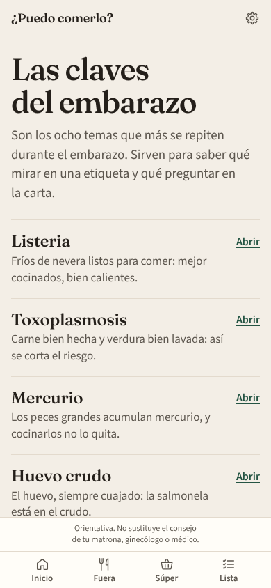

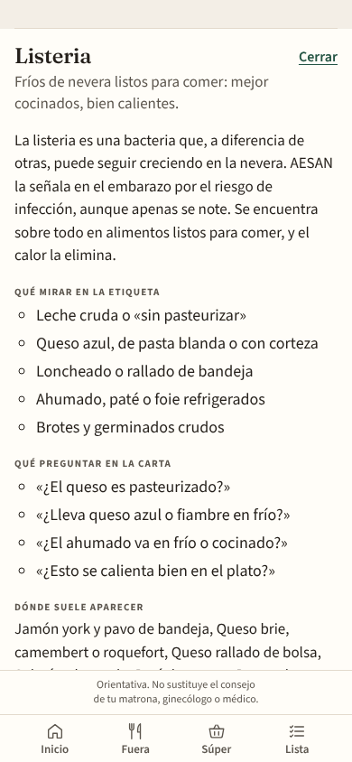

También llegas desde una respuesta: en **Ver más**, bajo «Para saber más», el tema aparece como un botón y
un enlace **«Por qué importa»**. Y en «Lo que he mirado en la etiqueta», cada tema hallado lleva el mismo
enlace. Al final de la pantalla: «Si tienes una duda sobre tu caso, pregúntasela a tu matrona.»

---

## 8. Lista de la compra, favoritos e historial

**Lista de la compra.** Para guardar lo que vas a comprar: en una respuesta, toca **Añadir a la lista**; en
una fila de la carta, abre **Ver más** y toca **Añadir a la lista**. Al principio la lista está vacía.

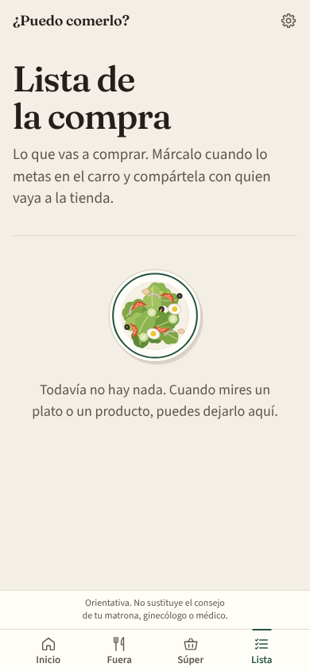

En la pestaña **Lista** ves arriba cuántos hay **pendientes** y el botón **Compartir la lista**. Cada fila
lleva su banda de color, su dibujo, y una casilla **Comprado** a la izquierda.

- **Pendiente.** Lo que aún no has comprado, ordenado de lo más tranquilo a lo más delicado: «Sí», «Con
  cuidado», «No estoy segura» y «Mejor no». Se recalcula con tus ajustes de ahora (si mañana marcas una
  alergia, la lista se pone al día). En un «Mejor no» que sale por tus ajustes verás «Sale «Mejor no» con
  tus ajustes».
- **Comprado.** Marca la casilla cuando metas algo en el carro: pasa a **En el carro**, tachado. Se puede
  plegar y, con **Vaciar lo comprado**, se quita de la lista. Si te equivocas, vuelve a tocar la casilla.
- **Compartir la lista.** Abre la hoja de compartir del móvil (o la copia, con «Lista copiada.»). Se
  comparte **solo lo pendiente**: «Mi lista de la compra» y una línea por producto, **sin semáforo y sin
  nada del embarazo**. Sirve para mandársela a quien vaya a la tienda.
- **Quitar** borra una fila de la lista.

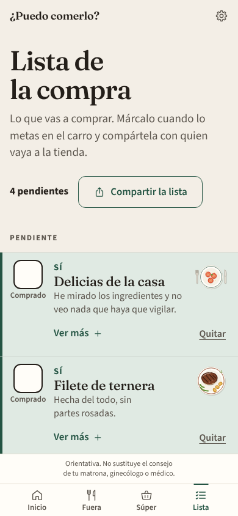

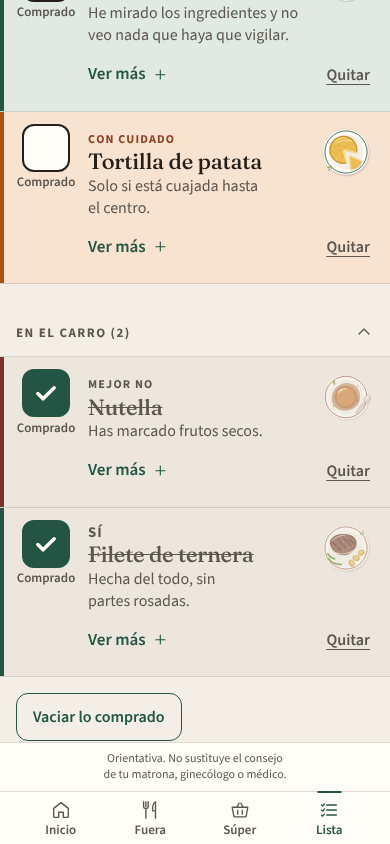

**Favoritos.** En la ficha de un alimento (por ejemplo, al tocar un atajo), **Guardar en favoritos**.
Aparecen debajo de la lista.

**Historial.** Guarda tus últimas 40 consultas (búsquedas, fotos, códigos y fichas abiertas). En Inicio
verás las tres últimas en **«Lo último»**; el historial completo, en **Ver el historial** (en Inicio o en
Ajustes). Desde ahí puedes **Borrar el historial** sin tocar la lista ni los favoritos.

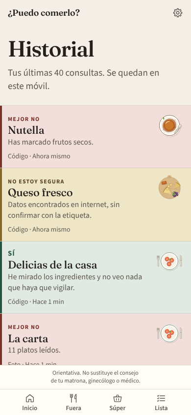

Todo esto se queda en tu móvil y sigue ahí aunque cierres o recargues la app.

---

## 9. Ajustes

Toca la **ruedecita** de arriba a la derecha.

- **Cambiar tus decisiones.** Arriba está todo lo del arranque: alergias, otra cosa que no quieras comer y
  dietas y restricciones. Cambia lo que quieras y toca **Guardar**. Verás «Guardado. Las respuestas ya usan
  estos ajustes.» Desde ese momento, todas las respuestas, la lista y el historial usan lo nuevo.
- **Historial.** **Ver el historial.**
- **Las claves del embarazo.** **Ver las claves.**
- **En la pantalla de inicio.** **Instalar en el móvil** lleva a los pasos para ponerla en la pantalla de
  inicio (apartado 10). Si ya la tienes instalada, lo dice.
- **Tus datos.** **Borrar los datos de este móvil** borra tus ajustes, la lista, los favoritos y el
  historial. Te pide confirmación (**Borrar todo**), no se puede deshacer y vuelves al arranque, como el
  primer día.

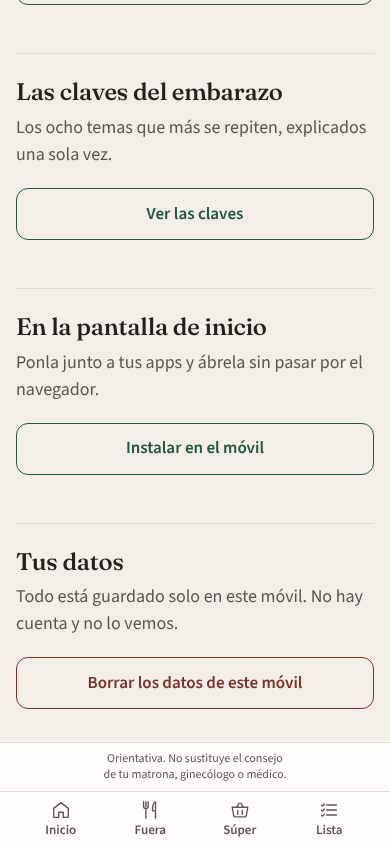

---

## 10. Instalarla en el móvil

No hace falta tienda de apps. Se pone en la pantalla de inicio, con su icono, y se abre sin la barra del
navegador. No pide permisos al instalarla y tus datos siguen solo en el móvil. Los mismos pasos están en
la app, en **Ajustes → Instalar en el móvil**, con tu tipo de móvil primero y marcado como **Tu móvil**.

**iPhone (con Safari; tiene que ser Safari):**

1. Abre el enlace de la app en **Safari**.
2. Toca el botón **Compartir** (el cuadrado con una flecha hacia arriba). Si no lo ves, toca antes los
   tres puntos de la barra de Safari.
3. Elige **«Añadir a pantalla de inicio»** (si no aparece, desliza la lista hacia arriba o toca
   «Ver más»).
4. Toca **«Añadir»**, arriba a la derecha. Si sale «Abrir como app web», déjalo activado.

**Android (con Chrome):**

1. Abre el enlace de la app en **Chrome**.
2. Toca el menú **⋮** (los tres puntos, arriba a la derecha).
3. Elige **«Instalar aplicación»** o **«Añadir a pantalla de inicio»** (el nombre cambia según la
   versión).
4. Confirma con **«Instalar»** o **«Añadir»**.

En algunos Android la pantalla de Instalar muestra directamente un botón **Instalar**: basta con tocarlo.

Una vez instalada, **sigue necesitando internet** para abrirse, igual que en el navegador.

---

## 11. Privacidad, en claro

- **No hay cuentas.** No te registras ni pones correo ni contraseña.
- **Todo se queda en tu móvil.** Tus alergias, tus dietas, la lista, los favoritos y el historial se
  guardan solo en el navegador de este móvil. Nadie más los ve, tampoco quien hizo la app. No pasan a otro
  móvil.
- **No te pide datos de salud.** Ni semana de embarazo, ni fecha de parto, ni analíticas.
- **La foto solo se lee.** Cuando haces una foto de una carta o de una etiqueta, se usa únicamente para
  sacar el texto (los nombres de los platos y los ingredientes) y **no se guarda**. La foto viaja a Claude
  para que la lea; solo si no puede, se lee en el propio móvil y no sale de él. Quien la lee no decide
  nada: solo copia lo que ve.
- **El semáforo lo calculan reglas fijas** que van dentro de la app, en tu móvil, a partir de ese texto
  y de tus ajustes. La misma pregunta con los mismos ajustes da siempre la misma respuesta.
- **Los códigos de barras** se consultan en Open Food Facts. Solo se envía el número del código; tus
  alergias no salen del móvil.
- **La búsqueda en internet** de un producto manda únicamente el número del código y, si Open Food Facts lo
  conoce, el nombre y la marca del producto. Nada tuyo.
- **Compartir la lista** manda solo lo que tú elijas compartir: los nombres de lo pendiente.

---

## 12. Prueba de 5 minutos (familia y amigos)

Gracias por probarla. Hazlo en tu móvil, con el enlace que te hayan pasado. Ten a mano una carta de
restaurante (en papel, en una foto o en una web) y algo de la despensa con código de barras. Apunta
cualquier cosa que te extrañe y en qué paso.

1. **Arranque (4 pasos).** Abre el enlace.
   - Paso 1: verás la portada «¿Puedo comerlo?» con una mesa de platos. Toca **Seguir**.
   - Paso 2, «Alergias e intolerancias»: **no marques nada** esta vez → **Seguir**.
   - Paso 3, «Dietas y restricciones»: **Seguir**.
   - Paso 4, «Tu privacidad»: **Empezar**.
   - *Deberías ver:* «¿Qué vas a comer?». En ningún paso te ha pedido semana, fecha ni analíticas, ni te ha
     preguntado por embutidos.
2. **Filete de ternera.** En «O escribe el plato», escribe `filete de ternera` y toca la lupa.
   - *Deberías ver:* **Sí**, con la pantalla verde y chispas, y debajo **«Ojo con esto»**: «Que esté hecha
     del todo, sin partes rosadas.»
3. **Café.** Escribe `café`.
   - *Deberías ver:* **Sí**, con un aviso de moderación («Con moderación: lleva cafeína.»).
4. **Tortilla.** Escribe `tortilla`.
   - *Deberías ver:* **Con cuidado**, con la pantalla naranja y signos de interrogación, y una
     **«Pregunta»**: «¿La tortilla está cuajada del todo?» Toca **Ver más**: sale una alternativa, el tema
     «Huevo crudo» y «Fuente: AESAN».
5. **Sushi.** Escribe `sushi`.
   - *Deberías ver:* **Mejor no**, con la pantalla rojo vino y una cruz, «Crudo, mejor no: puede llevar
     listeria y anisakis.»
6. **Jamón serrano y pizza de jamón york.** Escribe `jamón serrano` y luego `pizza de jamón york`.
   - *Deberías ver:* `jamón serrano` → **Mejor no** («Curado y sin cocinar, mejor no: AESAN lo señala por
     toxoplasmosis.»). `pizza de jamón york` → **Sí** («Va horneada, y el horno cocina lo que lleva
     encima.»), con un «Ojo con esto» sobre lo de encima.
   - (Si escribes solo `jamón york`, sale **Mejor no**: en frío, de bandeja.)
   - *Y si escribes algo sin sentido* (`asdf`), **No estoy segura**, en ocre.
7. **Foto de una carta.** Ve a **Fuera** → **Hacer una foto** (o **Elegir una foto** si la tienes en la
   galería). Dale permiso a la cámara si te lo pide.
   - *Deberías ver:* unos 4 segundos de «Leyendo la carta…» con un plato que gira y luego «La carta», con una
     fila de color por plato y su dibujo. **No** debería salir el aviso «He leído la carta de forma
     aproximada»: si sale, apúntalo. Si no se puede leer, debe decir «No he podido leer la carta. Acércala,
     o escribe el plato.», sin inventarse platos.
8. **Código de barras de la despensa.** Ve a **Súper** → **Escanear el código** y apunta al código de algo de
   la despensa (o escribe los números y toca **Consultar**; si no tienes nada a mano, prueba con
   `3017620422003`).
   - *Deberías ver:* la pantalla del color de la respuesta, con el código, la palabra y el nombre del
     producto.
   - Si sale **«Me faltan los ingredientes»** y «Voy a mirar si lleva: …», toca **Fotografiar los
     ingredientes** y haz la foto de la lista: debería salir **«Lo que he mirado en la etiqueta»**, tema por
     tema.
   - Si el producto no está, la app lo busca en internet («Buscando en internet…», 10–20 segundos, con
     **Cancelar**) o dice «No lo encuentro. Fotografía los ingredientes y lo miro por ti.»
9. **Lista y recarga.** Vuelve a buscar `tortilla` y toca **Añadir a la lista**. Ve a **Lista**.
   - *Deberías ver:* «Tortilla», «Con cuidado», en «Pendiente». Marca **Comprado**: pasa a **En el carro**.
     Toca **Compartir la lista** con algo aún pendiente: debería ofrecerte compartir un texto sin colores.
   - Ahora **recarga la página** (en el móvil, desliza hacia abajo o usa el botón de recargar). Lo que
     guardaste tiene que seguir en la lista.

**Extra, si te sobra un minuto:** en Ajustes marca la alergia **Huevo** → **Guardar**, y vuelve a la
Lista. La tortilla debería pasar a **Mejor no** con «Has marcado huevo.» Y entra en **Las claves del
embarazo** para ver los ocho temas.

Cuando acabes, cuéntanos: qué te ha resultado confuso, si algún color o signo de interrogación te ha
sorprendido (y con qué plato o producto), y si se te ha tapado algo en la pantalla.

---

## 13. Preguntas frecuentes

**¿Por qué sale naranja («Con cuidado»)?**
Porque la respuesta depende de un dato que no se ve en el plato, y ese dato puede convertir un «Sí» en un
«Mejor no»: por ejemplo, si el huevo de la tortilla está crudo por dentro, o si un queso blando no es
pasteurizado. Lee la **«Pregunta»** que sale debajo y hazla en la mesa. Si es buena, el plato pasa a ser un
«Sí».

**¿Qué es «Ojo con esto»?**
Son avisos cortos que salen debajo de un «Sí», para lo que conviene vigilar de siempre: que la carne esté
hecha del todo, que la verdura esté lavada, que el queso sea pasteurizado o tomar el café con moderación. El
«Sí» sigue siendo «Sí»: significa que se puede tomar tal como se sirve normalmente.

**¿Por qué sale «No estoy segura»?**
Porque la app no conoce el plato o el producto (o le faltan los ingredientes). No lo da por seguro y no se
inventa la respuesta. Abre **Ver más**: te dice qué preguntar. Prueba a escribirlo con el nombre más
corriente, o fotografía los ingredientes.

**¿Por qué no encuentra mi producto?**
Open Food Facts es una base abierta y no tiene todos los productos, sobre todo de marca blanca; en los
supermercados que hemos probado solo trae los ingredientes en unos 3 de cada 10. Mercadona, además, no
publica los códigos de barras en su web. Cuando falta, la app lo busca en internet y, si no lo encuentra, te
pide la foto de los ingredientes: con ella lo mira por ti.

**¿Qué hace la lista?**
Es una lista de la compra de verdad: guardas lo que vas a comprar, lo marcas como **Comprado** al meterlo en
el carro, te quedas con lo **Pendiente** y puedes **compartirla** (solo lo pendiente, sin semáforo) con quien
vaya a la tienda. Cada producto sigue mostrando su color, recalculado con tus ajustes.

**¿Cuántas fotos puedo hacer?**
Hasta **20 fotos cada 10 minutos**. Si te pasas, la app no se rompe: lee la foto con el lector del propio
móvil, que es más lento y menos fino (verás el aviso de lectura aproximada). Buscar un plato, escanear un
código o abrir una ficha no cuenta. La búsqueda de un producto en internet tiene su propio límite: 6 cada 10
minutos.

**¿Se puede usar sin conexión?**
No. Necesita internet para abrirse, para leer fotos y para consultar códigos de barras, también si la tienes
instalada en la pantalla de inicio.

**¿Por qué una pizza de jamón york sale «Sí» y el jamón york solo, «Mejor no»?**
Porque el fiambre de bandeja en frío puede llevar listeria, y el horno la elimina cuando va cocinado
dentro del plato. Con el jamón curado pasa lo mismo: cocinado dentro del plato, «Sí»; crudo, o puesto al
final en frío, «Mejor no» (apartado 4).

**El jamón serrano me sale «Mejor no» y yo lo como. ¿Puedo cambiarlo?**
No: la app no te pregunta por los embutidos y aplica siempre la misma regla prudente. Si tu matrona o tu
médico te han dicho otra cosa para tu caso, haz lo que ellos te digan.

**Los dibujos y las animaciones me molestan. ¿Se pueden quitar?**
Activa **«Reducir movimiento»** en los ajustes de accesibilidad del móvil: todo se queda quieto. Las
palabras y los colores no cambian.

**¿Qué pasa si borro los datos del navegador?**
Se pierde todo lo que has guardado: tus alergias, la lista, los favoritos y el historial. La app no tiene
copia, porque no se guarda en ningún otro sitio. La próxima vez que la abras, empezará por el arranque. Lo
mismo ocurre si usas **Borrar los datos de este móvil** en Ajustes.

**¿Lo que configuro en un móvil aparece en otro?**
No. No hay cuentas ni sincronización: cada móvil tiene lo suyo.

---

*Para quien administre la app (publicación, clave de lectura de fotos, límites de gasto): está todo en
[DESPLIEGUE.md](DESPLIEGUE.md).*

Orientativa. No sustituye el consejo de tu matrona, ginecólogo o médico.
