# Guía de uso de «¿Puedo comerlo?»

Para quien la va a usar y para quien la va a probar. Se lee en el móvil en unos diez minutos.

---

## Índice

1. [Qué es y qué no es](#1-qué-es-y-qué-no-es)
2. [Qué significa cada color](#2-qué-significa-cada-color)
3. [El primer arranque](#3-el-primer-arranque)
4. [Comer fuera](#4-comer-fuera)
5. [En el súper](#5-en-el-súper)
6. [Lista, favoritos e historial](#6-lista-favoritos-e-historial)
7. [Ajustes](#7-ajustes)
8. [Instalarla en el móvil](#8-instalarla-en-el-móvil)
9. [Privacidad, en claro](#9-privacidad-en-claro)
10. [Prueba de 5 minutos (familia y amigos)](#10-prueba-de-5-minutos-familia-y-amigos)
11. [Preguntas frecuentes](#11-preguntas-frecuentes)

---

## 1. Qué es y qué no es

«¿Puedo comerlo?» te da una respuesta corta antes de pedir en un restaurante o de meter algo en el carro
durante el embarazo. Primero la respuesta; el motivo, solo si lo abres.

- **Es una guía orientativa.** No es una app médica y no hay un médico detrás.
- **No sustituye a tu matrona, a tu ginecólogo ni a tu médico.** Si tienes una duda sobre tu caso,
  pregúntales a ellos. Por eso, abajo, en todas las pantallas, verás siempre esta frase:
  «Orientativa. No sustituye el consejo de tu matrona, ginecólogo o médico.»
- **Sus fuentes son públicas:** la AESAN (Agencia Española de Seguridad Alimentaria y Nutrición) y notas
  del Ministerio de Sanidad. Cada ficha dice de dónde sale. Cuando la app no reconoce un plato, lo dice
  y no se inventa la respuesta.
- **No te pide nada clínico:** ni semana de embarazo, ni fecha de parto, ni analíticas.

---

## 2. Qué significa cada color

Siempre verás una de estas cuatro respuestas, con su color y su palabra:

| Respuesta | Color | Qué quiere decir |
|---|---|---|
| **Sí** | verde salvia | Se puede tomar, con las precauciones normales. |
| **Con cuidado** | arcilla (teja) | Depende de cómo esté hecho. La ficha dice qué preguntar o mirar. |
| **Mejor no** | vino (granate) | Mejor no tomarlo en el embarazo. La ficha propone una alternativa. |
| **No estoy segura** | arena | La app no lo tiene claro y no lo da por seguro. Pregunta qué lleva. |

**Gana el peor.** Si un plato junta varias cosas, se queda con la respuesta más prudente:
«Mejor no» manda sobre «Con cuidado», que manda sobre «No estoy segura», que manda sobre «Sí».
Por ejemplo, una ensalada con salmón ahumado sale «Mejor no» por el ahumado, aunque la ensalada sola
fuera «Con cuidado».

**Ver más.** Cada ficha enseña solo la pastilla de color, el nombre y una frase. Si tocas **Ver más**
se despliega el resto: el motivo, la pregunta para el camarero o lo que hay que mirar en la etiqueta,
una alternativa y la fuente.

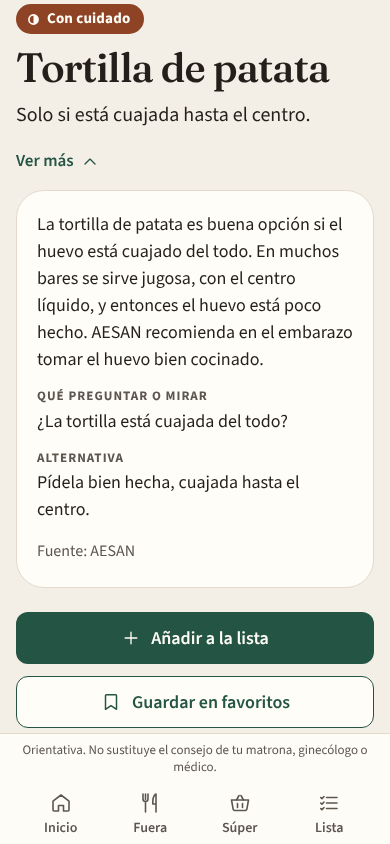

---

## 3. El primer arranque

La primera vez que la abres te hace seis preguntas cortas, una sola vez. Lo que contestes se puede
cambiar después en Ajustes.

**Paso 1. Portada.** Explica qué es la app y te enseña los cuatro colores. Toca **Seguir**.

**Paso 2. Embutido y jamón curado.** El jamón, el chorizo, el salchichón, el fuet o el lomo embuchado,
en crudo, son carne sin cocinar. AESAN los señala por toxoplasmosis y, si van loncheados, también por
listeria. La app **no te pregunta por analíticas**: tú decides si entran o no en tu mesa. Elige una de
las tres opciones (es obligatorio elegir una):

- **No quiero comer embutidos.** Jamón, chorizo, salchichón, fuet o lomo salen «Mejor no» siempre,
  también en croqueta o en pizza.
- **Solo si van cocinados.** En crudo, «Mejor no». Cocinados de verdad dentro del plato (croqueta,
  guiso, lentejas con chorizo, pizza al horno), «Sí».
- **Los como, y quiero ver el riesgo.** En crudo no pasan a «Sí»: siguen saliendo «Mejor no», con una
  línea que explica el motivo. La decisión, en la mesa, es tuya. Cocinados dentro del plato, «Sí».

**El fiambre de bandeja va aparte** (jamón york, pavo, chopped, mortadela). No depende de esta
decisión:

- **En frío** (en un bocadillo, en una ensalada o tal cual), sale **«Mejor no»**, por listeria, aunque
  el jamón curado te dé igual.
- **Cocinado dentro del plato** (pizza, sándwich mixto, croqueta, lasaña), sale **«Sí»**.

Un detalle: si el embutido se pone **al final, en frío**, encima de un plato ya hecho («pizza con
jamón serrano al final»), cuenta como crudo.

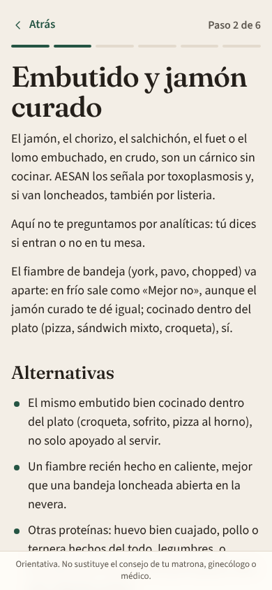

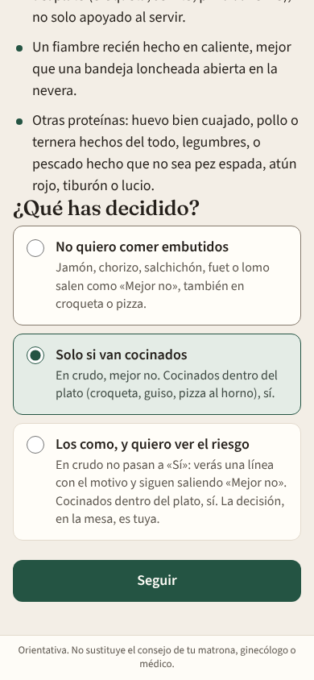

**Paso 3. ¿Cuáles comes?** Solo sale si no has elegido «No quiero». Marca los que comes: jamón curado;
chorizo o sobrasada; salchichón, fuet o salami; lomo embuchado. Los que no marques saldrán «Mejor no»,
con la frase «No está entre los embutidos que has marcado.» **Si no marcas ninguno, se aplican todos.**

**Paso 4. Alergias.** Opcional: leche, huevo, gluten, frutos secos, pescado, marisco, soja, sésamo.
Debajo hay un campo corto (hasta 200 letras) para **otra cosa que no quieras comer**, por ejemplo
«cilantro». Si algo de lo que marques aparece en el plato o en la etiqueta, sale «Mejor no».

**Paso 5. Forma de comer.** Opcional y se pueden marcar varias: vegetariana, vegana, sin cerdo, sin
lactosa. **No cambia el color**; solo añade una nota en la ficha, como «No encaja con vegana» o
«Lleva cerdo».

**Paso 6. Tu privacidad.** Tres frases: no te pedimos la semana ni analíticas; tus alergias y tu lista
se quedan en este móvil y no hay cuenta; la foto se envía solo para leer el texto, no se guarda, y el
semáforo lo calculan reglas fijas. Toca **Empezar**.

Llegas a **Inicio**: «¿Qué vas a comer?». Desde aquí vas a **Comer fuera**, a **En el súper**, o
escribes un plato directamente.

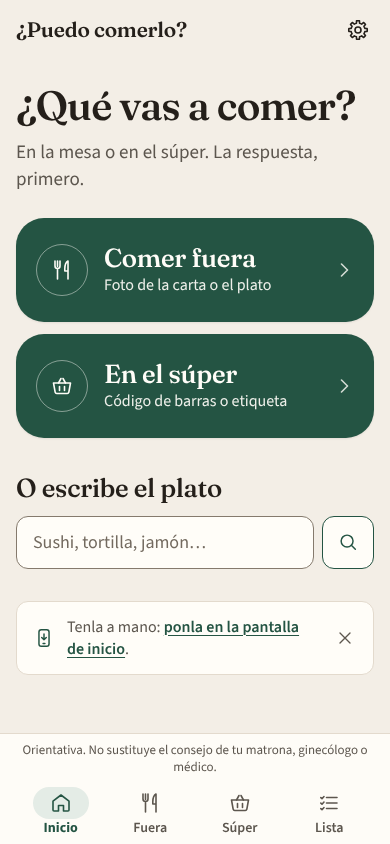

Abajo tienes siempre cuatro botones: **Inicio, Fuera, Súper y Lista**. Arriba a la derecha, la
ruedecita lleva a **Ajustes**.

---

## 4. Comer fuera

En **Fuera** (o «Comer fuera» desde Inicio) tienes tres maneras de preguntar:

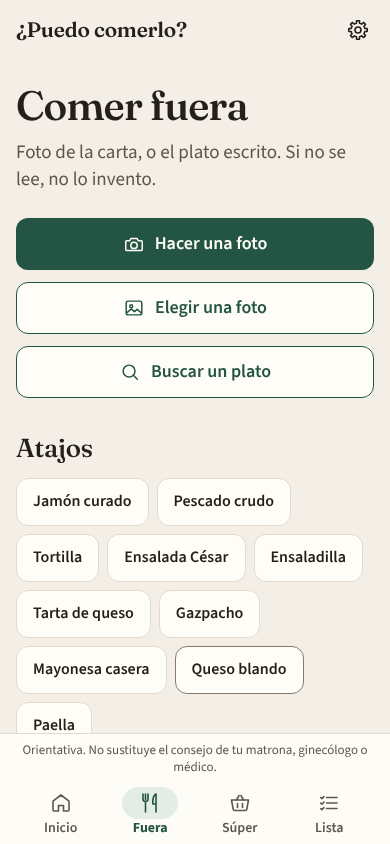

**Hacer una foto.** Abre la cámara de atrás. Encuadra la carta, con buena luz, y toca **Hacer la foto**.
Verás la foto congelada: si se lee bien, toca **Usar esta foto**; si no, **Repetir**. La primera vez, el
navegador te pedirá permiso para usar la cámara. Si no hay cámara o no le das permiso, te lo dice y te
ofrece elegir una foto de la galería.

**Elegir una foto.** Para una foto que ya tengas en el móvil (por ejemplo, la carta que te han mandado
por WhatsApp).

Mientras lee, verás la foto y un mensaje. Suele tardar unos segundos.

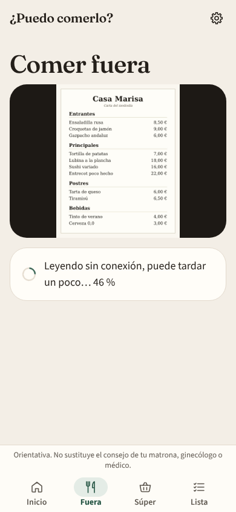

Después sale **«La carta»** con una ficha por plato (hasta 12), cada una con su color. Toca **Ver más**
en el que te interese. Abajo del todo, **Hacer otra foto**.

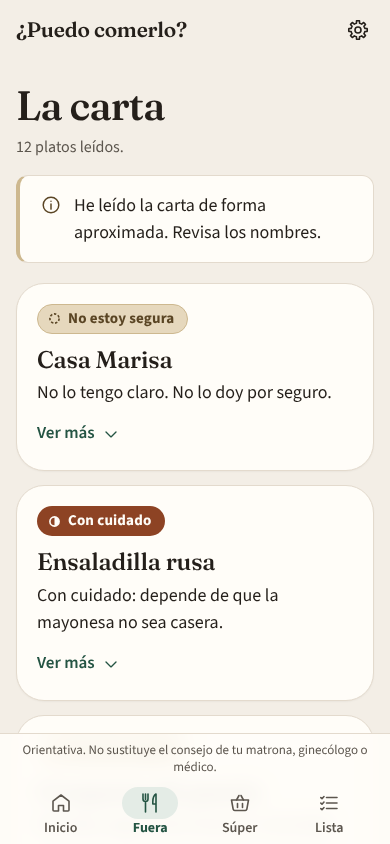

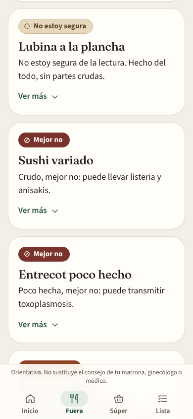

**El aviso «He leído la carta de forma aproximada. Revisa los nombres.»** Sale cuando la foto la ha leído
el lector del propio móvil, que es menos fino. En ese caso:

- Revisa que los nombres de los platos estén bien escritos.
- Ningún plato sale «Sí» a secas: lo que habría sido «Sí» baja a **«No estoy segura»**, con la frase
  «No estoy segura de la lectura.» delante. Si el nombre está bien leído, puedes escribir el plato para
  confirmarlo.
- A veces se cuela una línea que no es un plato (el nombre del restaurante, un título). Sale «No estoy
  segura»; no le hagas caso.

**Si no se lee**, la app no se inventa nada y te dice: «No he podido leer la carta. Acércala, o escribe
el plato.» Prueba otra foto más cerca y con más luz, o escríbelo.

**Buscar un plato.** Escribe el nombre como lo dirías: «sushi», «tortilla», «pizza de jamón york»,
«lentejas con chorizo»… No hace falta poner tildes. Arriba sale **«Tu respuesta»** para lo que has
escrito, y debajo **«En la guía»**, los alimentos parecidos que puedes abrir. Debajo del buscador hay
filtros por grupo (Embutidos, Lácteos, Huevos, Carne, Pescado, En el restaurante, Bebidas,
Supermercado). También puedes escribir el plato directamente en Inicio, en «O escribe el plato».

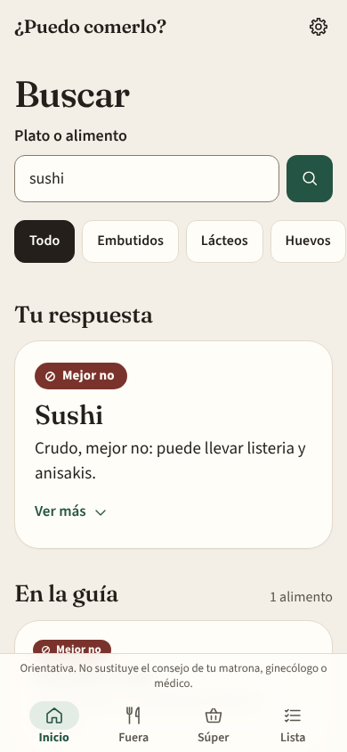

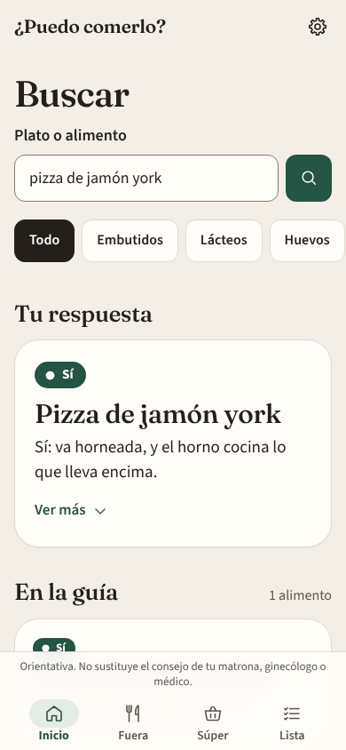

**Atajos.** Los botones de abajo abren directamente la ficha de lo más habitual: jamón curado, pescado
crudo, tortilla, ensalada César, ensaladilla, tarta de queso, gazpacho, mayonesa casera, queso blando y
paella.

---

## 5. En el súper

En **Súper** (o «En el súper» desde Inicio):

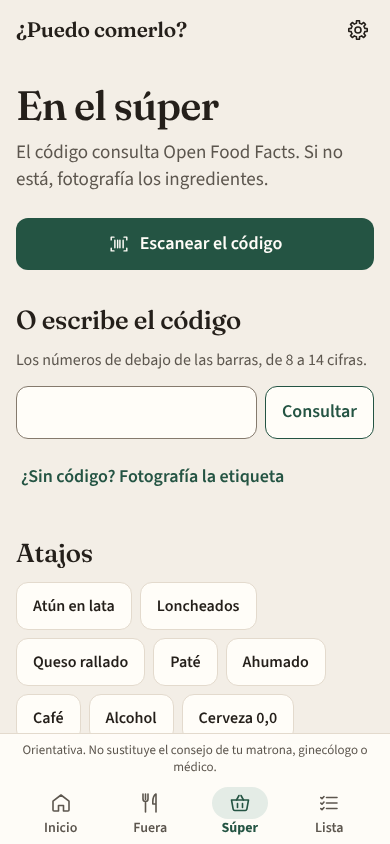

**Escanear el código.** Abre la cámara; apunta al código de barras y lo lee solo. La app lo busca en
**Open Food Facts**, una base de datos abierta de productos.

**Escribir el código.** Si la cámara no lo coge, teclea los números de debajo de las barras (de 8 a 14
cifras) y toca **Consultar**.

Sale el producto con su nombre, el código y una ficha. En **Ver más** verás los ingredientes que figuran
en Open Food Facts.

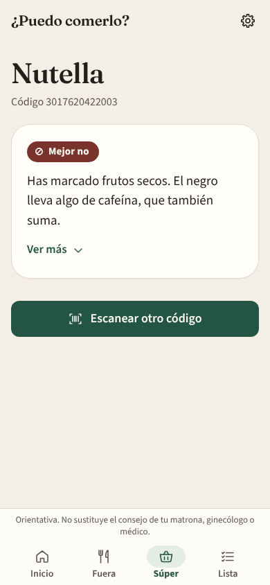

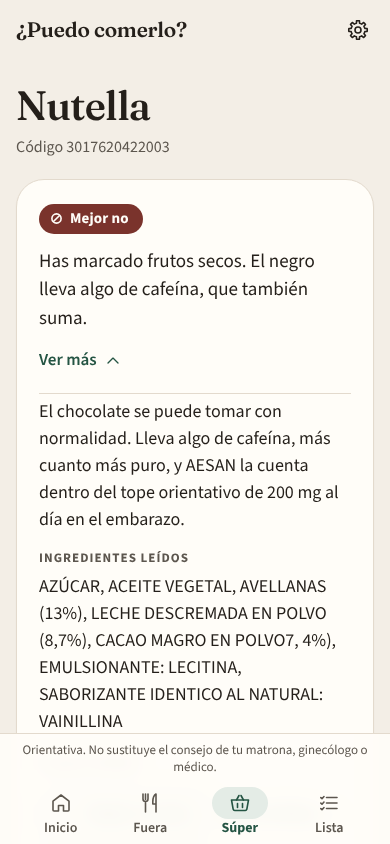

**Si no está en Open Food Facts**, te lo dice («No está en Open Food Facts. Haz una foto de los
ingredientes.») y te ofrece **Fotografiar la etiqueta**. Haz la foto de la lista de ingredientes, no del
frente del paquete. Si el producto no tiene código, usa **«¿Sin código? Fotografía la etiqueta»**.

**Cómo se aplican tus alergias:**

- Si una alergia que has marcado aparece en los ingredientes o en los alérgenos del producto, sale
  **«Mejor no»** con la frase «Has marcado…» delante (en la captura, «Has marcado frutos secos», por
  las avellanas).
- Si solo aparece en las **trazas** («puede contener…»), una respuesta que habría sido «Sí» baja a
  **«Con cuidado»**, con «Puede llevar trazas de…» delante.
- Lo mismo con «otra cosa que no quieras comer»: si aparece, «Mejor no».

**Atajos del súper:** atún en lata, loncheados, queso rallado, paté, ahumado, café, alcohol y cerveza
0,0.

---

## 6. Lista, favoritos e historial

**Lista.** Para guardar lo que te interesa: en una ficha de la guía, toca **Añadir a la lista**; en una
respuesta, una carta o un producto, abre **Ver más** y toca **Añadir a la lista**. En la pestaña
**Lista** lo verás todo con su color, recalculado con tus ajustes de ahora (si mañana marcas una
alergia, la lista se pone al día). **Quitar** lo borra de la lista.

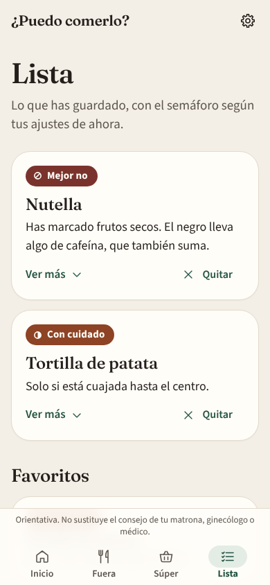

**Favoritos.** En la ficha de un alimento de la guía, **Guardar en favoritos**. Aparecen debajo de la
lista.

**Historial.** Guarda tus últimas 40 consultas (búsquedas, fotos, códigos y fichas abiertas). En Inicio
verás las tres últimas en **«Lo último»**; el historial completo, en **Ver el historial** (en Inicio o
en Ajustes). Desde ahí puedes **Borrar el historial** sin tocar la lista ni los favoritos.

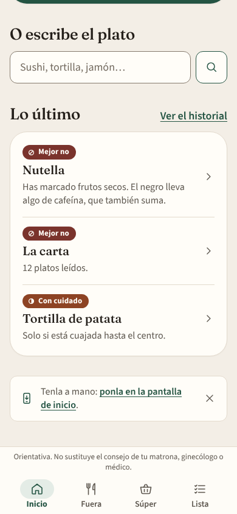

Todo esto se queda en tu móvil y sigue ahí aunque cierres o recargues la app.

---

## 7. Ajustes

Toca la **ruedecita** de arriba a la derecha.

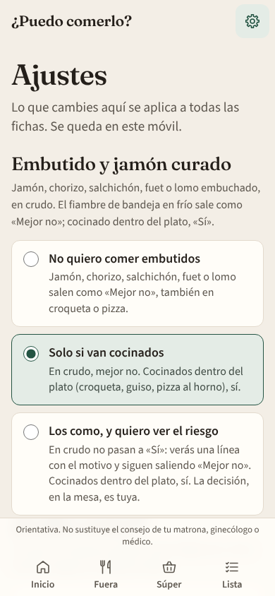

- **Cambiar tus decisiones.** Arriba está todo lo del arranque: embutido y jamón curado, cuáles comes,
  alergias, otra cosa que no quieras comer y forma de comer. Cambia lo que quieras y toca **Guardar**.
  Verás «Guardado. Las fichas ya usan estos ajustes.» Desde ese momento, todas las fichas, la lista y el
  historial usan lo nuevo.
- **Ver el historial.**
- **Instalar en el móvil.** Lleva a los pasos para ponerla en la pantalla de inicio (apartado 8). Si ya
  la tienes instalada, lo dice.
- **Borrar los datos de este móvil.** Borra tus ajustes, la lista, los favoritos y el historial. Te pide
  confirmación (**Borrar todo**), no se puede deshacer y vuelves al arranque, como el primer día.

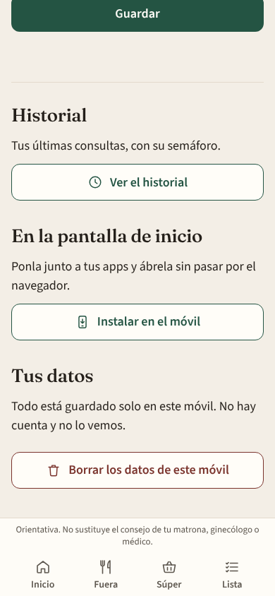

---

## 8. Instalarla en el móvil

No hace falta tienda de apps. Se pone en la pantalla de inicio, con su icono, y se abre sin la barra del
navegador. No pide permisos al instalarla y tus datos siguen solo en el móvil. Los mismos pasos están en
la app, en **Ajustes → Instalar en el móvil**, con tu tipo de móvil primero.

**iPhone (con Safari; tiene que ser Safari):**

1. Abre el enlace de la app en **Safari**.
2. Toca el botón **Compartir** (el cuadrado con una flecha hacia arriba). Si no lo ves, toca antes los
   tres puntos de la barra de Safari.
3. Elige **«Añadir a pantalla de inicio»** (si no aparece, desliza la lista hacia arriba o toca
   «Ver más»).
4. Toca **«Añadir»**, arriba a la derecha. Si sale «Abrir como app web», déjalo activado.

**Android (con Chrome):**

1. Abre el enlace de la app en **Chrome**.
2. Toca el menú **⋮** (los tres puntos, arriba a la derecha).
3. Elige **«Instalar aplicación»** o **«Añadir a pantalla de inicio»** (el nombre cambia según la
   versión).
4. Confirma con **«Instalar»** o **«Añadir»**.

En algunos Android la pantalla de Instalar muestra directamente un botón **Instalar**: basta con tocarlo.

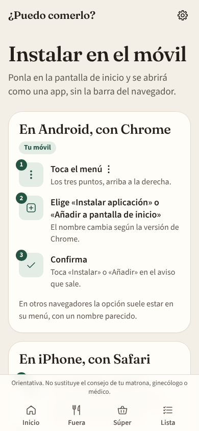

Una vez instalada, **sigue necesitando internet** para abrirse, igual que en el navegador.

---

## 9. Privacidad, en claro

- **No hay cuentas.** No te registras ni pones correo ni contraseña.
- **Todo se queda en tu móvil.** Tus decisiones sobre el embutido, tus alergias, la lista, los
  favoritos y el historial se guardan solo en el navegador de este móvil. Nadie más los ve, tampoco
  quien hizo la app. No pasan a otro móvil.
- **No te pide datos de salud.** Ni semana de embarazo, ni fecha de parto, ni analíticas.
- **La foto solo se lee.** Cuando haces una foto de una carta o de una etiqueta, se envía únicamente
  para sacar el texto (los nombres de los platos y los ingredientes) y **no se guarda**. Lo que la lee no
  decide nada.
- **El semáforo lo calculan reglas fijas** que van dentro de la app, en tu móvil, a partir de ese texto
  y de tus ajustes. La misma pregunta con los mismos ajustes da siempre la misma respuesta.
- **Los códigos de barras** se consultan en Open Food Facts. Solo se envía el número del código; tus
  alergias no salen del móvil.

---

## 10. Prueba de 5 minutos (familia y amigos)

Gracias por probarla. Hazlo en tu móvil, con el enlace que te hayan pasado. Ten a mano una carta de
restaurante (en papel, en una foto o en una web) y algo de la despensa con código de barras. Apunta
cualquier cosa que te extrañe y en qué paso.

1. **Arranque.** Abre el enlace. Verás la portada «¿Puedo comerlo?» con los cuatro colores. Toca
   **Seguir**.
   - En «Embutido y jamón curado», elige **Solo si van cocinados** → **Seguir**.
   - En «¿Cuáles comes?», no marques nada → **Seguir**.
   - En «Alergias», **no marques nada** esta vez → **Seguir**.
   - En «Forma de comer», **Seguir**. En «Tu privacidad», **Empezar**.
   - *Deberías ver:* «¿Qué vas a comer?». En ningún paso te ha pedido semana, fecha ni analíticas.
2. **Sushi.** En «O escribe el plato», escribe `sushi` y toca la lupa.
   - *Deberías ver:* **Mejor no** (granate), «Crudo, mejor no: puede llevar listeria y anisakis.»
3. **Tortilla.** Vuelve a Inicio y escribe `tortilla`.
   - *Deberías ver:* **Con cuidado** (teja), «Solo si está cuajada hasta el centro.» Toca **Ver más**:
     sale qué preguntar, una alternativa y «Fuente: AESAN».
4. **Pizza de jamón york.** Escribe `pizza de jamón york`.
   - *Deberías ver:* **Sí** (verde), «Sí: va horneada, y el horno cocina lo que lleva encima.»
   - (Si escribes solo `jamón york`, sale **Mejor no**: en frío, de bandeja.)
5. **Foto de una carta real.** Ve a **Fuera** → **Hacer una foto** (o **Elegir una foto** si la tienes en
   la galería). Dale permiso a la cámara si te lo pide.
   - *Deberías ver:* unos segundos de «Leyendo…» y luego «La carta», con una ficha de color por plato.
     Si sale el aviso «He leído la carta de forma aproximada», es normal: revisa que los nombres estén
     bien. Si no se puede leer, debe decir «No he podido leer la carta. Acércala, o escribe el plato.»,
     sin inventarse platos.
6. **Código de barras.** Ve a **Súper** → **Escanear el código** y apunta al código de algo de la
   despensa (o escribe los números y toca **Consultar**).
   - *Deberías ver:* el nombre del producto, su código y una ficha de color. Si no está en Open Food
     Facts, debe decírtelo y ofrecerte **Fotografiar la etiqueta**: prueba con la lista de ingredientes.
7. **Lista y recarga.** Vuelve a buscar `tortilla`, toca **Ver más** → **Añadir a la lista**. Ve a
   **Lista**.
   - *Deberías ver:* la tortilla de patata, «Con cuidado».
   - Ahora **recarga la página** (en el móvil, desliza hacia abajo o usa el botón de recargar). La
     tortilla tiene que seguir en la lista.

**Extra, si te sobra un minuto:** en Ajustes marca la alergia **Huevo** → **Guardar**, y vuelve a la
Lista. La tortilla debería pasar a **Mejor no** con «Has marcado huevo.»

Cuando acabes, cuéntanos: qué te ha resultado confuso, si algún color te ha sorprendido (y con qué plato
o producto), y si se te ha tapado algo en la pantalla.

---

## 11. Preguntas frecuentes

**¿Por qué sale «No estoy segura»?**
Porque la app no reconoce el plato o la foto se ha leído de forma aproximada. No lo da por seguro y no se
inventa la respuesta. Abre **Ver más**: te dice qué preguntar (si lleva huevo crudo, embutido, queso sin
pasteurizar, alcohol o pescado sin hacer). Prueba también a escribirlo de otra forma, con el nombre más
corriente.

**¿Se puede usar sin conexión?**
No. Necesita internet para abrirse, para leer fotos y para consultar códigos de barras, también si la
tienes instalada en la pantalla de inicio.

**¿Qué pasa si borro los datos del navegador?**
Se pierde todo lo que has guardado: tus decisiones, alergias, la lista, los favoritos y el historial.
La app no tiene copia, porque no se guarda en ningún otro sitio. La próxima vez que la abras, empezará
por el arranque. Lo mismo ocurre si usas **Borrar los datos de este móvil** en Ajustes.

**¿Cuántas fotos puedo hacer?**
Hasta **20 fotos cada 10 minutos**. Si te pasas, la app no se rompe: lee la foto con el lector del
propio móvil, que es más lento y menos fino (verás el aviso de lectura aproximada). Buscar un plato,
escanear un código o abrir la guía no cuenta.

**¿Lo que configuro en un móvil aparece en otro?**
No. No hay cuentas ni sincronización: cada móvil tiene lo suyo.

**¿Por qué una pizza de jamón york sale «Sí» y el jamón york solo, «Mejor no»?**
Porque el fiambre de bandeja en frío puede llevar listeria, y el horno la elimina cuando va cocinado
dentro del plato. Con el jamón curado pasa lo mismo si eliges «Solo si van cocinados» o «Los como».

---

*Para quien administre la app (publicación, clave de lectura de fotos, límites de gasto): está todo en
[DESPLIEGUE.md](DESPLIEGUE.md).*

Orientativa. No sustituye el consejo de tu matrona, ginecólogo o médico.
