# Guía de uso de «¿Puedo comerlo?»

Para quien la va a usar y para quien la va a probar. Se lee en el móvil en unos diez minutos.

---

## Índice

1. [Qué es y qué no es](#1-qué-es-y-qué-no-es)
2. [Los colores](#2-los-colores)
3. [El primer arranque](#3-el-primer-arranque)
4. [Cómo trata la app los embutidos y los fiambres](#4-cómo-trata-la-app-los-embutidos-y-los-fiambres)
5. [Comer fuera](#5-comer-fuera)
6. [En el súper](#6-en-el-súper)
7. [Lista, favoritos e historial](#7-lista-favoritos-e-historial)
8. [Ajustes](#8-ajustes)
9. [Instalarla en el móvil](#9-instalarla-en-el-móvil)
10. [Privacidad, en claro](#10-privacidad-en-claro)
11. [Prueba de 5 minutos (familia y amigos)](#11-prueba-de-5-minutos-familia-y-amigos)
12. [Preguntas frecuentes](#12-preguntas-frecuentes)

---

## 1. Qué es y qué no es

«¿Puedo comerlo?» te da una respuesta corta antes de pedir en un restaurante o de meter algo en el carro
durante el embarazo. Primero la respuesta; el motivo, solo si lo abres.

- **Es orientativa.** No es una app médica y no hay un médico detrás.
- **No sustituye a tu matrona, a tu ginecólogo ni a tu médico.** Si tienes una duda sobre tu caso,
  pregúntales a ellos. Por eso, abajo, en todas las pantallas, verás siempre esta frase:
  «Orientativa. No sustituye el consejo de tu matrona, ginecólogo o médico.»
- **Sus fuentes son públicas:** la AESAN (Agencia Española de Seguridad Alimentaria y Nutrición) y notas
  del Ministerio de Sanidad. Cada respuesta dice de dónde sale. Cuando la app no entiende un plato, lo
  dice y no se inventa la respuesta.
- **No te pide nada clínico:** ni semana de embarazo, ni fecha de parto, ni analíticas.

---

## 2. Los colores

Cuando la app te contesta sobre **un plato o un producto**, se pinta **la pantalla entera** del color de la
respuesta, también la barra de arriba y la de abajo, y la palabra aparece grande. Hay cuatro:

| Respuesta | Color de la pantalla | Qué quiere decir |
|---|---|---|
| **Sí** | verde salvia | Se puede tomar, con las precauciones normales. |
| **Con cuidado** | naranja terroso | Depende de cómo esté hecho. La respuesta dice qué preguntar o mirar. |
| **Mejor no** | rojo vino | Mejor no tomarlo en el embarazo. Si hay una alternativa, la propone. |
| **No estoy segura** | ocre | La app no lo tiene claro y no lo da por seguro. Pregunta qué lleva. |

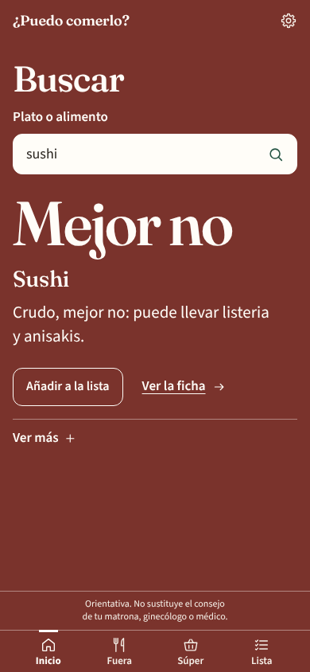

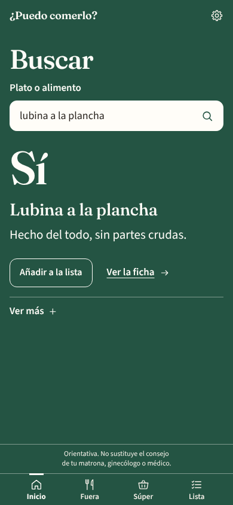

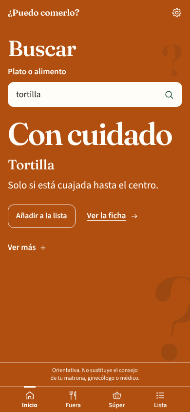

- **No te fíes solo del color.** Siempre hay una **palabra** grande («Sí», «Con cuidado», «Mejor no», «No
  estoy segura») y una frase. «Con cuidado» y «No estoy segura» llevan además signos de interrogación de
  fondo (más grandes y numerosos en «No estoy segura»), para distinguirlos de un vistazo, incluso si no
  distingues bien los colores.
- **Gana el peor.** Si un plato junta varias cosas, se queda con la respuesta más prudente:
  «Mejor no» manda sobre «Con cuidado», que manda sobre «No estoy segura», que manda sobre «Sí».
  Por ejemplo, una ensalada con salmón ahumado sale «Mejor no» por el ahumado, aunque la ensalada sola
  fuera «Con cuidado».
- **Las listas no se pintan enteras.** La carta, tu lista, el historial y «Lo último» van sobre fondo crema:
  cada plato es una fila con una **banda suave del color** de su respuesta, una marca de color en el borde
  y la palabra pequeña encima del nombre. Solo las respuestas sueltas pintan toda la pantalla.

**Ver más.** Primero ves la palabra, el nombre y una frase. Si tocas **Ver más** se despliega una hoja con el
resto: el motivo, la pregunta para el camarero o lo que hay que mirar en la etiqueta, una alternativa y la
fuente.

---

## 3. El primer arranque

La primera vez que la abres te hace tres pantallas cortas, una sola vez (cuatro pasos contando la portada).
Lo que contestes se puede cambiar después en Ajustes. Arriba verás siempre «Paso 1 de 4» y una barra de
progreso; con **Atrás** vuelves al paso anterior.

**Paso 1. Portada.** Explica qué es la app, con una mesa de platos vista desde arriba (en una esquina, una servilleta con una
silueta bordada de embarazada). Toca **Seguir**; debajo del botón está el aviso de que es orientativa.

**Paso 2. Alergias e intolerancias.** Opcional: leche, huevo, gluten, frutos secos, pescado, marisco, soja y
sésamo. Debajo hay un campo corto (hasta 200 letras) para **otra cosa que no quieras comer**, por ejemplo
«cilantro». Si algo de lo que marques aparece en el plato o en la etiqueta, sale «Mejor no».

**Paso 3. Dietas y restricciones.** Opcional y se pueden marcar varias: vegetariana, vegana, sin cerdo, sin
lactosa (intolerancia). **No cambia la respuesta ni su color**; solo añade una nota en la respuesta, como «No encaja con
vegana» o «Lleva cerdo».

**Paso 4. Tu privacidad.** Tres frases: no te pedimos la semana de embarazo ni analíticas; tus alergias y tu
lista se quedan en este móvil y no hay cuenta; la foto se envía solo para leer el texto, no se guarda, y el
semáforo lo calculan reglas fijas. Toca **Empezar**.

Llegas a **Inicio**: «¿Qué vas a comer?». Hay dos accesos grandes, **Comer fuera** y **En el súper**, y
debajo un campo para escribir el plato directamente. Más abajo, «Lo último» (vacío al principio, con un plato
dibujado) y un aviso discreto que te ofrece ponerla en la pantalla de inicio del móvil; lo puedes cerrar con
la «x».

Abajo tienes siempre cuatro botones: **Inicio, Fuera, Súper y Lista**. Arriba a la derecha, la
ruedecita lleva a **Ajustes**.

---

## 4. Cómo trata la app los embutidos y los fiambres

La app **no te pregunta** por los embutidos: aplica siempre la misma regla prudente, en todos los móviles.
Si tu matrona o tu médico te han dicho algo distinto para tu caso, haz lo que ellos te digan.

- **Crudo, «Mejor no».** El jamón curado (el serrano, por ejemplo), el chorizo, el salchichón, el fuet y el
  lomo embuchado se curan sin cocinar. AESAN los señala por toxoplasmosis. Ejemplos: «jamón serrano»,
  «chorizo», «fuet», «bocadillo de lomo embuchado».
- **Cocinado dentro del plato, «Sí».** Si el embutido se cocina de verdad con el plato y llega bien
  caliente, el calor elimina el riesgo. Ejemplos: «pizza de jamón serrano», «croquetas de jamón», «guiso de
  chorizo», «lentejas con chorizo», «sándwich mixto caliente».
- **El fiambre de bandeja en frío, «Mejor no».** El jamón york, las lonchas de pavo o el chopped, en un
  bocadillo, en una ensalada o tal cual, pueden llevar listeria. Ejemplos: «jamón york», «bocadillo de
  jamón york», «lonchas de pavo». Cocinado dentro del plato (pizza, croqueta, lasaña, sándwich mixto
  caliente), sale «Sí»: «pizza de jamón york».
- **Lo que se añade en frío al final cuenta como crudo.** «Pizza con jamón serrano al final» o «pizza de
  jamón crudo» salen «Mejor no», aunque la pizza esté horneada.

---

## 5. Comer fuera

En **Fuera** (o «Comer fuera» desde Inicio) tienes tres maneras de preguntar:

**Hacer una foto.** Abre la cámara de atrás. Encuadra la carta, con buena luz, y toca **Hacer la foto**.
Verás la foto congelada: si se lee bien, toca **Usar esta foto**; si no, **Repetir**. La primera vez, el
navegador te pedirá permiso para usar la cámara. Si no hay cámara o no le das permiso, te lo dice y te
ofrece elegir una foto de la galería.

**Elegir una foto.** Para una foto que ya tengas en el móvil (por ejemplo, la carta que te han mandado
por WhatsApp).

**Quién lee la foto.** La lee Claude (el modelo Sonnet 5.5): tarda unos 4 segundos y es lo más fino. Solo si
no puede (por ejemplo, si te has pasado del límite de fotos o falla la conexión con él), la foto se lee en
el propio móvil. Entonces tarda unos segundos más, es menos fina y la app te lo avisa con «He leído la
carta de forma aproximada» (más abajo).

Mientras lee, verás la foto y un plato con tenedor y cuchillo que gira, con un mensaje («Leyendo la carta…»):

Después sale **«La carta»**: cuántos platos ha leído (hasta 12), un resumen por colores y una fila por plato.
Toca **Ver más** en el que te interese. Abajo del todo, **Hacer otra foto**.

*Estas capturas se hicieron sin la lectura de Claude, con el lector del propio móvil: por eso salen el aviso
de lectura aproximada y varios «No estoy segura». En tu móvil, con Claude, la lectura sale más limpia: sin
aviso y con los nombres de los platos mejor leídos.*

**El aviso «He leído la carta de forma aproximada. Revisa los nombres.»** Solo sale cuando la foto se ha
leído en el propio móvil (no cuando la lee Claude). En ese caso:

- Revisa que los nombres de los platos estén bien escritos.
- Ningún plato sale «Sí» a secas: lo que habría sido «Sí» baja a **«No estoy segura»**, con la frase
  «No estoy segura de la lectura.» delante. Si el nombre está bien leído, escribe el plato en **Buscar**
  para confirmarlo.
- A veces se cuela una línea que no es un plato (el nombre del restaurante, un título). Sale «No estoy
  segura»; no le hagas caso.

**Si no se lee**, la app no se inventa nada y te dice: «No he podido leer la carta. Acércala, o escribe
el plato.» Prueba otra foto más cerca y con más luz, o escríbelo.

**Buscar un plato.** Con **Buscar un plato**, o escribiendo en Inicio en «O escribe el plato», sale una
pantalla con el campo y **solo la respuesta**, con la pantalla del color de la respuesta: la palabra grande, el nombre, una frase,
**Añadir a la lista** y **Ver más**. Escribe el plato como lo dirías: «sushi», «tortilla», «pizza de jamón york»,
«lentejas con chorizo»… No hace falta poner tildes. La respuesta (y el color) se van actualizando mientras escribes.
Cuando la respuesta sale de un único alimento conocido, aparece también **Ver la ficha**.

Si escribes algo que la app no entiende, sale **«No estoy segura»**, y en **Ver más** te dice qué
preguntar (si lleva huevo crudo, embutido, queso sin pasteurizar, alcohol o pescado sin hacer).

**Atajos.** Debajo de los botones hay una lista de texto con lo más habitual: jamón curado, pescado crudo,
tortilla, ensalada César, ensaladilla, tarta de queso, gazpacho, mayonesa casera, queso blando y paella.
Tocas uno y se abre su ficha, con su respuesta. También salen en Buscar cuando el campo está vacío.

---

## 6. En el súper

En **Súper** (o «En el súper» desde Inicio):

**Escanear el código.** Abre la cámara; apunta al código de barras y lo lee solo. La app lo busca en
**Open Food Facts**, una base de datos abierta de productos.

**Escribir el código.** Si la cámara no lo coge, teclea los números de debajo de las barras (de 8 a 14
cifras) y toca **Consultar**.

Sale el producto, con la pantalla del color de su respuesta: el código, la palabra grande, su nombre y la frase. En **Ver más** verás los
ingredientes que figuran en Open Food Facts.

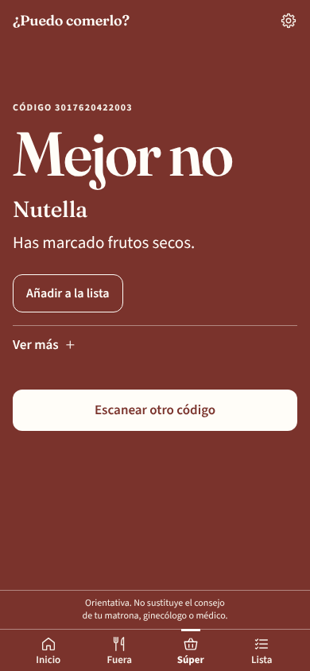

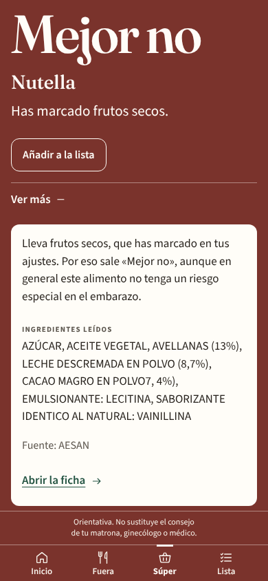

**Si no está en Open Food Facts**, te lo dice («No está en Open Food Facts. Haz una foto de los
ingredientes.») y te ofrece **Fotografiar la etiqueta**. Haz la foto de la lista de ingredientes, no del
frente del paquete. Si el producto no tiene código, usa **«¿Sin código? Fotografía la etiqueta»**. La foto
de la etiqueta se lee igual que la de la carta (con Claude o, si no puede, en el propio móvil con el aviso de
lectura aproximada).

**Cómo se aplican tus alergias:**

- Si una alergia que has marcado aparece en los ingredientes o en los alérgenos del producto, sale
  **«Mejor no»** con la frase «Has marcado…» delante (en la captura, «Has marcado frutos secos», por
  las avellanas).
- Si solo aparece en las **trazas** («puede contener…»), una respuesta que habría sido «Sí» baja a
  **«Con cuidado»**, con «Puede llevar trazas de…» delante.
- Lo mismo con «otra cosa que no quieras comer»: si aparece, «Mejor no».

**Atajos del súper:** atún en lata, loncheados, queso rallado, paté, ahumado, café, alcohol y cerveza
0,0.

---

## 7. Lista, favoritos e historial

**Lista.** Al principio está vacía, con un plato dibujado y «Todavía no hay nada…».

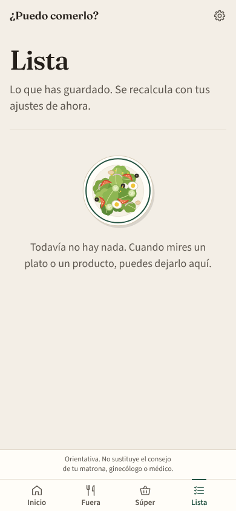

Para guardar lo que te interesa: en una respuesta, toca **Añadir a la lista**; en una fila de la
carta, abre **Ver más** y toca **Añadir a la lista**. En la pestaña **Lista** lo verás todo con su color,
recalculado con tus ajustes de ahora (si mañana marcas una alergia, la lista se pone al día). **Quitar** lo
borra de la lista.

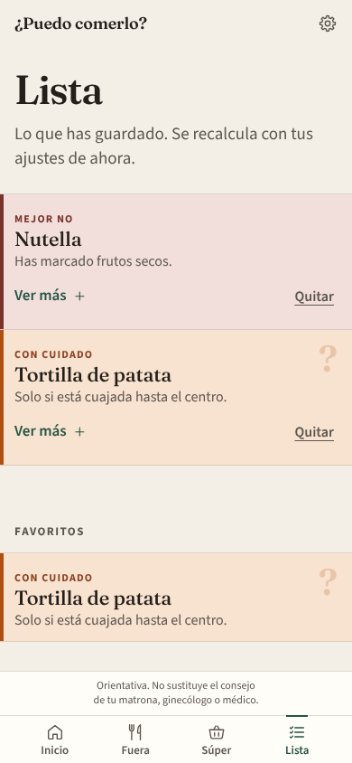

**Favoritos.** En la ficha de un alimento (por ejemplo, al tocar un atajo), **Guardar en favoritos**.
Aparecen debajo de la lista.

**Historial.** Guarda tus últimas 40 consultas (búsquedas, fotos, códigos y fichas abiertas). En Inicio
verás las tres últimas en **«Lo último»**; el historial completo, en **Ver el historial** (en Inicio o
en Ajustes). Desde ahí puedes **Borrar el historial** sin tocar la lista ni los favoritos. El historial vacío también
lleva un plato dibujado.

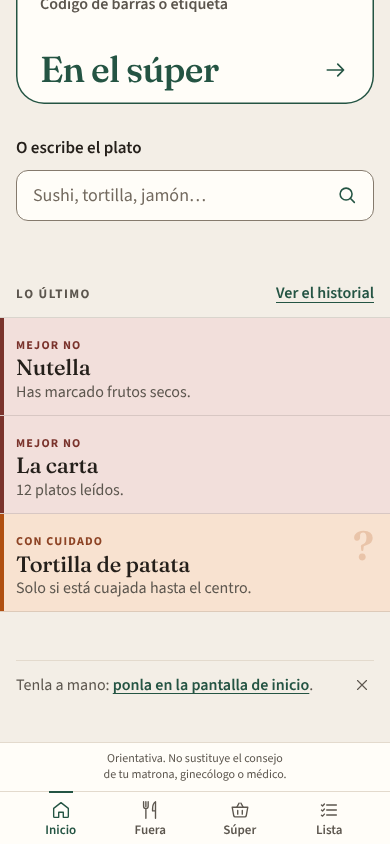

Todo esto se queda en tu móvil y sigue ahí aunque cierres o recargues la app.

---

## 8. Ajustes

Toca la **ruedecita** de arriba a la derecha.

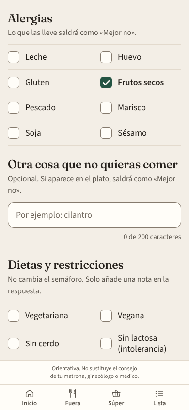

- **Cambiar tus decisiones.** Arriba está todo lo del arranque: alergias, otra cosa que no quieras comer y
  dietas y restricciones. Cambia lo que quieras y toca **Guardar**. Verás «Guardado. Las respuestas ya usan
  estos ajustes.» Desde ese momento, todas las respuestas, la lista y el historial usan lo nuevo.
- **Historial.** **Ver el historial.**
- **En la pantalla de inicio.** **Instalar en el móvil** lleva a los pasos para ponerla en la pantalla de
  inicio (apartado 9). Si ya la tienes instalada, lo dice.
- **Tus datos.** **Borrar los datos de este móvil** borra tus ajustes, la lista, los favoritos y el
  historial. Te pide confirmación (**Borrar todo**), no se puede deshacer y vuelves al arranque, como el
  primer día.

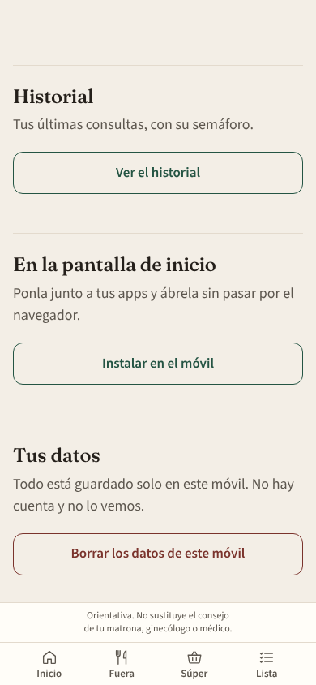

---

## 9. Instalarla en el móvil

No hace falta tienda de apps. Se pone en la pantalla de inicio, con su icono, y se abre sin la barra del
navegador. No pide permisos al instalarla y tus datos siguen solo en el móvil. Los mismos pasos están en
la app, en **Ajustes → Instalar en el móvil**, con tu tipo de móvil primero y marcado como **Tu móvil**.

**iPhone (con Safari; tiene que ser Safari):**

1. Abre el enlace de la app en **Safari**.
2. Toca el botón **Compartir** (el cuadrado con una flecha hacia arriba). Si no lo ves, toca antes los
   tres puntos de la barra de Safari.
3. Elige **«Añadir a pantalla de inicio»** (si no aparece, desliza la lista hacia arriba o toca
   «Ver más»).
4. Toca **«Añadir»**, arriba a la derecha. Si sale «Abrir como app web», déjalo activado.

**Android (con Chrome):**

1. Abre el enlace de la app en **Chrome**.
2. Toca el menú **⋮** (los tres puntos, arriba a la derecha).
3. Elige **«Instalar aplicación»** o **«Añadir a pantalla de inicio»** (el nombre cambia según la
   versión).
4. Confirma con **«Instalar»** o **«Añadir»**.

En algunos Android la pantalla de Instalar muestra directamente un botón **Instalar**: basta con tocarlo.

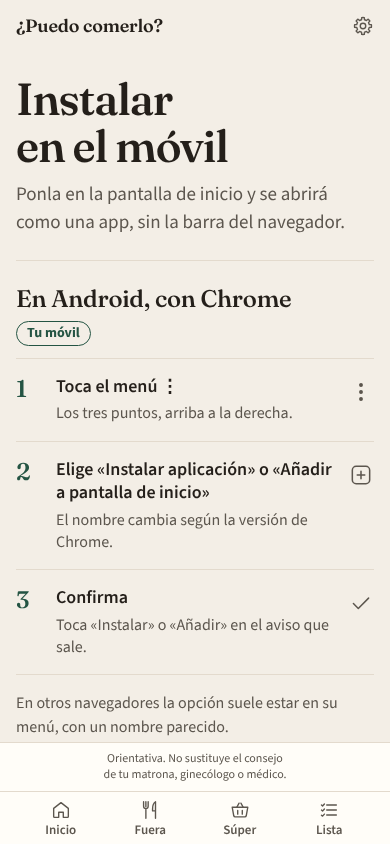

Una vez instalada, **sigue necesitando internet** para abrirse, igual que en el navegador.

---

## 10. Privacidad, en claro

- **No hay cuentas.** No te registras ni pones correo ni contraseña.
- **Todo se queda en tu móvil.** Tus alergias, tus dietas, la lista, los favoritos y el historial se
  guardan solo en el navegador de este móvil. Nadie más los ve, tampoco quien hizo la app. No pasan a otro
  móvil.
- **No te pide datos de salud.** Ni semana de embarazo, ni fecha de parto, ni analíticas.
- **La foto solo se lee.** Cuando haces una foto de una carta o de una etiqueta, se usa únicamente para
  sacar el texto (los nombres de los platos y los ingredientes) y **no se guarda**. La foto viaja a Claude
  para que la lea; solo si no puede, se lee en el propio móvil y no sale de él.
  Quien la lee no decide nada: solo copia lo que ve.
- **El semáforo lo calculan reglas fijas** que van dentro de la app, en tu móvil, a partir de ese texto
  y de tus ajustes. La misma pregunta con los mismos ajustes da siempre la misma respuesta.
- **Los códigos de barras** se consultan en Open Food Facts. Solo se envía el número del código; tus
  alergias no salen del móvil.

---

## 11. Prueba de 5 minutos (familia y amigos)

Gracias por probarla. Hazlo en tu móvil, con el enlace que te hayan pasado. Ten a mano una carta de
restaurante (en papel, en una foto o en una web) y algo de la despensa con código de barras. Apunta
cualquier cosa que te extrañe y en qué paso.

1. **Arranque (4 pasos).** Abre el enlace.
   - Paso 1: verás la portada «¿Puedo comerlo?». Toca **Seguir**.
   - Paso 2, «Alergias e intolerancias»: **no marques nada** esta vez → **Seguir**.
   - Paso 3, «Dietas y restricciones»: **Seguir**.
   - Paso 4, «Tu privacidad»: **Empezar**.
   - *Deberías ver:* «¿Qué vas a comer?». En ningún paso te ha pedido semana, fecha ni analíticas, ni te ha
     preguntado por embutidos.
2. **Sushi.** En «O escribe el plato», escribe `sushi` y toca la lupa.
   - *Deberías ver:* **Mejor no**, con la pantalla entera de color vino, «Crudo, mejor no: puede llevar listeria y anisakis.»
3. **Tortilla.** Vuelve a Inicio y escribe `tortilla`.
   - *Deberías ver:* **Con cuidado**, con la pantalla naranja y signos de interrogación de fondo, «Solo si está cuajada hasta el centro.» Toca **Ver más**:
     sale qué preguntar, una alternativa y «Fuente: AESAN».
4. **Pizza de jamón york.** Escribe `pizza de jamón york`.
   - *Deberías ver:* **Sí**, con la pantalla verde, «Va horneada, y el horno cocina lo que lleva encima.»
   - (Si escribes solo `jamón york`, sale **Mejor no**: en frío, de bandeja.)
5. **Jamón serrano.** Escribe `jamón serrano`.
   - *Deberías ver:* **Mejor no**, «Curado y sin cocinar, mejor no: AESAN lo señala por toxoplasmosis.»
6. **Foto de una carta.** Ve a **Fuera** → **Hacer una foto** (o **Elegir una foto** si la tienes en la
   galería). Dale permiso a la cámara si te lo pide.
   - *Deberías ver:* unos segundos (unos 4) de «Leyendo la carta…» con un plato que gira, y luego «La carta»,
     con una fila de color por plato. Si sale el aviso «He leído la carta de forma aproximada», quiere decir
     que se ha leído en el propio móvil: es normal, pero cuéntanoslo y revisa que los nombres estén bien. Si no se puede leer, debe decir «No he podido leer la carta. Acércala, o escribe el plato.»,
     sin inventarse platos.
7. **Código de barras.** Ve a **Súper** → **Escanear el código** y apunta al código de algo de la
   despensa (o escribe los números y toca **Consultar**; si no tienes nada a mano, prueba con
   `3017620422003`).
   - *Deberías ver:* la pantalla del color de la respuesta, con el código, la palabra y el nombre del producto. Si no está en Open Food
     Facts, debe decírtelo y ofrecerte **Fotografiar la etiqueta**: prueba con la lista de ingredientes.
8. **Lista y recarga.** Vuelve a buscar `tortilla` y toca **Añadir a la lista**. Ve a **Lista**.
   - *Deberías ver:* «Tortilla», «Con cuidado».
   - Ahora **recarga la página** (en el móvil, desliza hacia abajo o usa el botón de recargar). La
     tortilla tiene que seguir en la lista.

**Extra, si te sobra un minuto:** en Ajustes marca la alergia **Huevo** → **Guardar**, y vuelve a la
Lista. La tortilla debería pasar a **Mejor no** con «Has marcado huevo.»

Cuando acabes, cuéntanos: qué te ha resultado confuso, si algún color o signo de interrogación te ha sorprendido (y con qué plato
o producto), y si se te ha tapado algo en la pantalla.

---

## 12. Preguntas frecuentes

**¿Por qué sale «No estoy segura»?**
Porque la app no entiende el plato o la foto se ha leído de forma aproximada. No lo da por seguro y no se
inventa la respuesta. Abre **Ver más**: te dice qué preguntar (si lleva huevo crudo, embutido, queso sin
pasteurizar, alcohol o pescado sin hacer). Prueba también a escribirlo de otra forma, con el nombre más
corriente.

**¿Por qué una pizza de jamón york sale «Sí» y el jamón york solo, «Mejor no»?**
Porque el fiambre de bandeja en frío puede llevar listeria, y el horno la elimina cuando va cocinado
dentro del plato. Con el jamón curado pasa lo mismo: cocinado dentro del plato, «Sí»; crudo, o puesto al
final en frío, «Mejor no» (apartado 4).

**El jamón serrano me sale «Mejor no» y yo lo como. ¿Puedo cambiarlo?**
No: la app no te pregunta por los embutidos y aplica siempre la misma regla prudente. Si tu matrona o tu
médico te han dicho otra cosa para tu caso, haz lo que ellos te digan.

**¿Se puede usar sin conexión?**
No. Necesita internet para abrirse, para leer fotos con Claude y para consultar códigos de barras, también
si la tienes instalada en la pantalla de inicio.

**¿Qué pasa si borro los datos del navegador?**
Se pierde todo lo que has guardado: tus alergias, la lista, los favoritos y el historial. La app no tiene
copia, porque no se guarda en ningún otro sitio. La próxima vez que la abras, empezará por el arranque. Lo
mismo ocurre si usas **Borrar los datos de este móvil** en Ajustes.

**¿Cuántas fotos puedo hacer?**
Hasta **20 fotos cada 10 minutos**. Si te pasas, la app no se rompe: lee la foto
con el lector del propio móvil, que es más lento y menos fino (verás el aviso de lectura aproximada).
Buscar un plato, escanear un código o abrir una ficha no cuenta.

**¿Lo que configuro en un móvil aparece en otro?**
No. No hay cuentas ni sincronización: cada móvil tiene lo suyo.

---

*Para quien administre la app (publicación, clave de lectura de fotos, límites de gasto): está todo en
[DESPLIEGUE.md](DESPLIEGUE.md).*

Orientativa. No sustituye el consejo de tu matrona, ginecólogo o médico.
